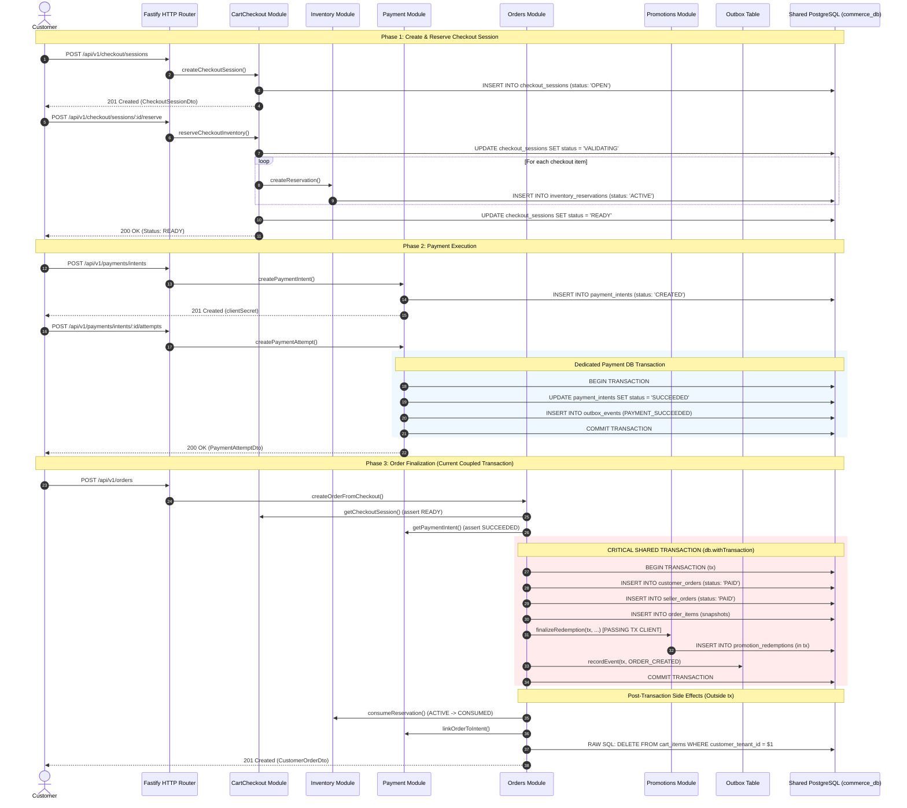

# CURRENT MONOLITH VALIDATED ANALYSIS

> **Document Status:** Comprehensive Validated Architectural Baseline  
> **Source Verification:** 100% verified against code in `apps/api/src/`, `apps/api/src/infra/database/migrations/`, `apps/web/src/`, `/ml/`, `/.ml_artifacts/`, and `.github/`  
> **Repository Safety Status:** READ-ONLY ANALYSIS — Zero application source code, package configurations, environment files, or databases modified.

---

## 1. Repository Structure

### Verification Against `CURRENT-MONOLITH-DISCOVERY.md`
- **DISCOVERY CLAIM:** Monorepo with `apps/api`, `apps/web`, and `packages/`.
- **VERIFIED FINDING:** **PARTIALLY INCORRECT.** 
  - Root `package.json` configures workspaces as `"workspaces": ["apps/*", "packages/*"]`.
  - However, **no `packages/` directory exists on disk**.
  - Crucially, `CURRENT-MONOLITH-DISCOVERY.md` **completely omitted** the root-level `/ml` directory (Python training/inference engine), the root-level `/.ml_artifacts` directory (231 serialized model files), and root-level `data.json` (demo catalog seed data).

### Actual Verified Repository Tree
```
/
├── apps/
│   ├── api/                              # Backend Fastify + TypeScript application
│   │   ├── src/
│   │   │   ├── architecture/             # Boundary linting rules (boundary-rules.ts)
│   │   │   ├── config/                   # Strongly-typed environment configuration (Zod)
│   │   │   ├── errors/                   # AppError hierarchy and HTTP error handler
│   │   │   ├── http/                     # Fastify route controllers (23 route files)
│   │   │   ├── infra/                    # Infrastructure adapters
│   │   │   │   ├── ai/                   # SqlAiStore (pgvector knowledge base)
│   │   │   │   ├── database/             # PostgreSQL pool, seeders, and 25 migrations
│   │   │   │   ├── ml/                   # SqlMlStore (PostgreSQL ML models & predictions store)
│   │   │   │   ├── redis/                # Redis connection and CacheService
│   │   │   │   └── search/               # SqlSearchStore (search projections)
│   │   │   ├── modules/                  # 21 modular monolith domain contexts
│   │   │   ├── observability/            # Structured JsonLogger and Correlation IDs
│   │   │   ├── app.ts                    # In-process dependency injection & Fastify bootstrap
│   │   │   └── server.ts                 # Server entry point (starts Fastify listener on port 4000)
│   │   ├── test/                         # 44 Vitest integration/unit test suites
│   │   ├── .env.example
│   │   └── package.json
│   └── web/                              # Frontend React 18 + Vite + Tailwind CSS application
│       ├── src/
│       │   ├── api/                      # Central HTTP client (client.ts with SWR cache)
│       │   ├── components/               # Shared UI atoms and molecules
│       │   ├── features/                 # 16 domain-aligned feature slices (UI + feature APIs)
│       │   ├── layouts/                  # CustomerLayout, MerchantLayout, AdminLayout
│       │   ├── routes/                   # Central React Router route tree (index.tsx)
│       │   └── index.css                 # Global CSS design tokens
│       ├── package.json
│       └── vite.config.ts
├── ml/                                   # ROOT-LEVEL PYTHON ML COMPONENT (OUTSIDE /apps)
│   ├── data/
│   │   ├── bootstrap.py                  # Synthetic data generators for cold-start tenants
│   │   └── features.py                   # Feature extraction for demand, stockout, propensity, anomaly
│   ├── models/
│   │   ├── anomaly_detector.py           # Isolation/RandomForest classifier for fraud detection
│   │   ├── demand_forecaster.py          # RandomForestRegressor / Ridge for product sales
│   │   ├── propensity_predictor.py       # Customer purchase propensity classifier
│   │   └── stockout_predictor.py         # Inventory runout probability classifier
│   ├── predict.py                        # CLI inference worker (reads stdin/JSON, outputs predictions)
│   ├── requirements.txt                  # Python 3.10+ dependencies (joblib, numpy, pandas, scikit-learn)
│   └── train.py                          # CLI training worker (fits models, serializes .joblib artifacts)
├── .ml_artifacts/                        # 231 local serialized .joblib model binaries (83+ MB)
├── .github/
│   └── workflows/
│       └── ci.yml                        # GitHub Actions CI workflow (Node.js 22 only; NO Python)
├── docs/                                 # Architecture specs and guidelines
├── data.json                             # 208 KB dummy catalog dataset for seeding
├── package.json                          # Monorepo root npm configuration
├── package-lock.json                     # Monorepo lockfile
├── README.md
└── STYLE.md                              # Authoritative frontend UI/UX design specifications
```

---

## 2. Business Modules

The monolithic backend defines **21 business modules** inside `apps/api/src/modules/`. Each module adheres to an internal structure:
- Public entry point: `apps/api/src/modules/<module-name>/index.ts`
- Private implementation: `apps/api/src/modules/<module-name>/internal/`

### Validated Module Inventory Matrix

| Module | Core Responsibility | Primary Database Tables | Reads | Writes | Events Published | Events Consumed | Key In-Memory Injected Dependencies |
|---|---|---|---|---|---|---|---|
| `identity` | User authentication, tenant memberships, password hashing (scrypt), token issuance, revocation | `users`, `tenants`, `tenant_memberships`, `refresh_tokens`, `email_verifications` | `users`, `tenants`, `tenant_memberships`, `refresh_tokens`, `email_verifications` | `users`, `tenants`, `tenant_memberships`, `refresh_tokens`, `email_verifications` | None | None | DatabaseConnection, Logger |
| `security-audit` | Append-only security event logging (login success/fail, token rotation, merchant verification) | `audit_logs` | `audit_logs` | `audit_logs` | None | None | DatabaseConnection, Logger |
| `merchant` | Merchant onboarding, legal profile, KYC verification state machine | `merchant_profiles` | `merchant_profiles`, `tenants`, `users` | `merchant_profiles` | None | None | DatabaseConnection, Logger |
| `catalog` | Master hierarchical categories, canonical products, variants/SKUs, product reviews & helpful votes | `categories`, `products`, `product_skus`, `product_descriptions`, `product_reviews`, `review_reports`, `review_helpful_votes` | `categories`, `products`, `product_skus`, `product_descriptions`, `product_reviews` | `categories`, `products`, `product_skus`, `product_descriptions`, `product_reviews`, `review_reports`, `review_helpful_votes` | `catalog.product.created.v1`, `catalog.product.updated.v1`, `catalog.product.archived.v1`, `review.submitted.v1`, `review.approved.v1`, `review.rejected.v1`, `review.updated.v1`, `review.deleted.v1` | None | DatabaseConnection, Logger, OutboxService |
| `marketplace` | Multi-vendor offers for canonical SKUs, merchant pricing, compare-at pricing, listing statuses | `merchant_listings` | `merchant_listings`, `product_skus`, `merchants` | `merchant_listings` | `marketplace.listing.created.v1`, `marketplace.listing.updated.v1`, `marketplace.listing.deactivated.v1` | None | DatabaseConnection, Logger, CatalogService, MerchantService |
| `inventory` | Real-time stock on-hand tracking, reservation holds, movement ledger, stockout audit | `inventory_items`, `inventory_reservations`, `inventory_movements` | `inventory_items`, `inventory_reservations`, `inventory_movements` | `inventory_items`, `inventory_reservations`, `inventory_movements` | `inventory.stock_changed.v1`, `inventory.stock_available.v1` | None | DatabaseConnection, Logger, MarketplaceService, OutboxService, CacheService |
| `customer` | Customer address book, customer wishlists, and back-in-stock subscriptions | `customer_addresses`, `order_address_snapshots`, `customer_wishlist_items`, `back_in_stock_subscriptions` | `customer_addresses`, `customer_wishlist_items`, `back_in_stock_subscriptions` | `customer_addresses`, `order_address_snapshots`, `customer_wishlist_items`, `back_in_stock_subscriptions` | `wishlist.item_added.v1`, `wishlist.item_removed.v1`, `customer.back_in_stock.subscribed.v1`, `customer.back_in_stock.unsubscribed.v1`, `customer.back_in_stock.notification_sent.v1` | `inventory.stock_available.v1` | DatabaseConnection, Logger, CartService, OutboxService, NotificationService |
| `cart-checkout` | Ephemeral customer shopping carts, price/quantity validation, checkout sessions, reservation orchestration | `carts`, `cart_items`, `checkout_sessions`, `checkout_items` | `carts`, `cart_items`, `checkout_sessions`, `checkout_items`, `merchant_listings`, `product_skus` | `carts`, `cart_items`, `checkout_sessions`, `checkout_items` | None | None | DatabaseConnection, Logger, MarketplaceService, CatalogService, InventoryService, CustomerAddressService |
| `orders` | Customer order and split seller-order creation, immutable line item snapshots, order status tracking | `customer_orders`, `seller_orders`, `order_items` | `customer_orders`, `seller_orders`, `order_items`, `checkout_sessions`, `payment_intents` | `customer_orders`, `seller_orders`, `order_items`, `cart_items` (RAW SQL) | `order.created.v1`, `order.status_changed.v1` | None | DatabaseConnection, Logger, CheckoutService, CatalogService, InventoryService, PaymentService, OutboxService, PromotionService |
| `payment` | Payment intent lifecycle, multi-provider execution (Stripe / Mock), attempts ledger, webhook replay deduplication, refunds | `payment_intents`, `payment_attempts`, `payment_webhook_events`, `payment_refunds` | `payment_intents`, `payment_attempts`, `payment_webhook_events`, `payment_refunds`, `checkout_sessions` | `payment_intents`, `payment_attempts`, `payment_webhook_events`, `payment_refunds` | `payment.succeeded.v1`, `payment.failed.v1`, `payment.refund_created.v1` | None | DatabaseConnection, Logger, CheckoutService, OutboxService, PaymentProvider |
| `fulfillment` | Multi-vendor shipments, carrier rate calculation, label generation (Shippo), tracking updates, returns workflow, restock | `shipments`, `shipment_items`, `returns`, `return_items`, `carrier_webhook_events`, `carrier_shipment_operations` | `shipments`, `shipment_items`, `returns`, `return_items`, `carrier_webhook_events`, `carrier_shipment_operations`, `seller_orders` | `shipments`, `shipment_items`, `returns`, `return_items`, `carrier_webhook_events`, `carrier_shipment_operations` | `fulfillment.shipment_created.v1`, `fulfillment.shipment_status_changed.v1`, `fulfillment.return_status_changed.v1` | None | DatabaseConnection, Logger, OrderService, PaymentService, InventoryService, CarrierProvider, OutboxService |
| `settlement-ledger` | Double-entry bookkeeping, merchant balances, commission calculations, adjustments, settlement cycles | `financial_accounts`, `financial_adjustments`, `settlements`, `ledger_entries`, `financial_transactions` | `financial_accounts`, `financial_adjustments`, `settlements`, `ledger_entries`, `financial_transactions`, `seller_orders` | `financial_accounts`, `financial_adjustments`, `settlements`, `ledger_entries`, `financial_transactions` | `settlement.status_changed.v1` | None | DatabaseConnection, Logger, OrderService, PaymentService |
| `promotion-pricing` | Cart promotions, coupon validation, usage limits, discount attribution across multi-vendor orders, redemption finalization | `promotions`, `coupons`, `promotion_redemptions` | `promotions`, `coupons`, `promotion_redemptions` | `promotions`, `coupons`, `promotion_redemptions` | `promotion.created.v1`, `promotion.updated.v1`, `promotion.activated.v1`, `promotion.deactivated.v1`, `promotion.coupon_redeemed.v1`, `promotion.coupon_redemption_reversed.v1` | None | DatabaseConnection, Logger, OutboxService |
| `search` | Product search projections, keyword search, faceted filters, zero-downtime double-buffering reindexing | `search_projection_state`, `search_product_projections`, `search_seller_offers` | `search_projection_state`, `search_product_projections`, `search_seller_offers` | `search_projection_state`, `search_product_projections`, `search_seller_offers` | None | `catalog.product.created.v1`, `catalog.product.updated.v1`, `catalog.product.archived.v1`, `marketplace.listing.created.v1`, `marketplace.listing.updated.v1`, `marketplace.listing.deactivated.v1`, `inventory.stock_changed.v1` | ISearchStore (SqlSearchStore), Logger, CatalogService, MarketplaceService, InventoryService, MerchantService |
| `analytics` | Fact tables, daily metrics aggregation, merchant sales/volume, platform revenue, asynchronous event projection | `analytics_order_facts`, `analytics_payment_facts`, `analytics_fulfillment_facts`, `analytics_daily_metrics`, `analytics_rebuild_audit` | `analytics_order_facts`, `analytics_payment_facts`, `analytics_fulfillment_facts`, `analytics_daily_metrics`, `analytics_rebuild_audit` | `analytics_order_facts`, `analytics_payment_facts`, `analytics_fulfillment_facts`, `analytics_daily_metrics`, `analytics_rebuild_audit` | None | `order.created.v1`, `order.status_changed.v1`, `payment.succeeded.v1`, `payment.failed.v1`, `fulfillment.shipment_status_changed.v1`, `fulfillment.return_status_changed.v1` | DatabaseConnection, Logger |
| `analytics-ml` | ML model registry, asynchronous training job orchestration, prediction generation via PythonRunner, retraining policies | `ml_models`, `ml_training_jobs`, `ml_predictions`, `ml_retraining_policies` | `ml_models`, `ml_training_jobs`, `ml_predictions`, `ml_retraining_policies`, `analytics_order_facts`, `analytics_daily_metrics` | `ml_models`, `ml_training_jobs`, `ml_predictions`, `ml_retraining_policies` | None | None | IMlStore (SqlMlStore), IAnalyticsMlFeatureReader (AnalyticsService), Logger, PythonRunner |
| `recommendations` | Candidate generation, heuristic & ML-assisted product scoring, trending ranking, personalized recommendations | `derived_recommendations`, `recommendation_rebuild_audit` | `derived_recommendations`, `recommendation_rebuild_audit`, `products`, `merchant_listings` | `derived_recommendations`, `recommendation_rebuild_audit` | None | `order.created.v1`, `catalog.product.created.v1`, `catalog.product.updated.v1` | DatabaseConnection, Logger, CatalogService, MarketplaceService, AnalyticsService, IMlSignalReader (MlService) |
| `price-alerts` | Customer price watches, notification triggering upon price reduction | `price_watches` | `price_watches`, `merchant_listings` | `price_watches` | None | `marketplace.listing.updated.v1` | DatabaseConnection, NotificationService, Logger |
| `notifications` | Multi-channel customer messaging (Email via Resend, SMS, Push, WhatsApp), preferences, retry scheduling | `customer_notification_preferences`, `notifications` | `customer_notification_preferences`, `notifications` | `notifications` | None | `order.created.v1`, `payment.succeeded.v1`, `fulfillment.shipment_status_changed.v1`, `customer.back_in_stock.notification_sent.v1` | DatabaseConnection, Logger, EmailProvider, WhatsAppProvider |
| `events` | Durable Transactional Outbox publishing, row lease claiming, consumer deduplication, in-memory event dispatch | `outbox_events`, `event_consumer_receipts` | `outbox_events`, `event_consumer_receipts` | `outbox_events`, `event_consumer_receipts` | Dispatches all recorded domain events | Dispatches to all registered consumers | DatabaseConnection, EventTransport (In-memory EventEmitter), Logger |
| `ai` | Conversational e-commerce assistant, RAG knowledge document embeddings, vector chunk search, WhatsApp bot | `ai_conversations`, `ai_messages`, `ai_knowledge_documents`, `ai_knowledge_document_versions`, `ai_vector_chunks` | `ai_conversations`, `ai_messages`, `ai_knowledge_documents`, `ai_knowledge_document_versions`, `ai_vector_chunks` | `ai_conversations`, `ai_messages`, `ai_knowledge_documents`, `ai_knowledge_document_versions`, `ai_vector_chunks` | None | None | DatabaseConnection, Logger, IAiStore (SqlAiStore), EmbeddingProvider, LLMProvider, WhatsAppProvider |

---

## 3. Module Dependencies

In [`apps/api/src/app.ts`](file:///c:/Users/Abhinav/Documents/Project2/ai-driven-multi-vendor-predictive-ecom-platform/apps/api/src/app.ts#L161-L384), all module instances are constructed in a single Node.js runtime and connected via constructor dependency injection.

### Verified Coupling Graph

| Source Module | Target Module | Coupling Mechanism | Code Evidence | Severity | Microservice Extraction Risk |
|---|---|---|---|---|---|
| `marketplace` | `catalog` | Synchronous constructor DI | `marketplaceModule.createService(db, log, catalogService, merchantService)` ([app.ts#L169](file:///c:/Users/Abhinav/Documents/Project2/ai-driven-multi-vendor-predictive-ecom-platform/apps/api/src/app.ts#L169)) | **High** | Listing creation synchronously checks if SKU exists in catalog. Must become gRPC API call or merge domains. |
| `marketplace` | `merchant` | Synchronous constructor DI | `marketplaceModule.createService(..., merchantService)` ([app.ts#L169](file:///c:/Users/Abhinav/Documents/Project2/ai-driven-multi-vendor-predictive-ecom-platform/apps/api/src/app.ts#L169)) | **Low** | Validates tenant verification status. |
| `inventory` | `marketplace` | Synchronous constructor DI | `inventoryModule.createService(db, log, marketplaceService, ...)` ([app.ts#L181](file:///c:/Users/Abhinav/Documents/Project2/ai-driven-multi-vendor-predictive-ecom-platform/apps/api/src/app.ts#L181)) | **Medium** | Stock items link to `listingId`. Inventory queries listing existence on stock creation. |
| `cart-checkout` (Cart) | `marketplace` | Synchronous constructor DI | `cartCheckoutModule.createCartService(db, log, marketplaceService)` ([app.ts#L188](file:///c:/Users/Abhinav/Documents/Project2/ai-driven-multi-vendor-predictive-ecom-platform/apps/api/src/app.ts#L188)) | **Medium** | Adding item to cart synchronously calls `marketplaceService.getListingById()`. |
| `cart-checkout` (Checkout) | `marketplace`, `catalog`, `inventory`, `customer` | Synchronous constructor DI | `cartCheckoutModule.createCheckoutService(db, log, marketplace, catalog, inventory, address)` ([app.ts#L202-L209](file:///c:/Users/Abhinav/Documents/Project2/ai-driven-multi-vendor-predictive-ecom-platform/apps/api/src/app.ts#L202-L209)) | **CRITICAL** | During session creation and reservation, synchronously verifies active listings, canonical SKUs, checks availability, and reserves stock. |
| `orders` | `cart-checkout` (Checkout) | Synchronous constructor DI | `ordersModule.createService(db, log, checkoutService, ...)` ([app.ts#L246-L255](file:///c:/Users/Abhinav/Documents/Project2/ai-driven-multi-vendor-predictive-ecom-platform/apps/api/src/app.ts#L246-L255)) | **CRITICAL** | Order creation synchronously reads `checkoutService.getCheckoutSession()`, verifying status is `READY`. |
| `orders` | `payment` | Synchronous constructor DI | Injected into `OrderService` constructor ([app.ts#L252](file:///c:/Users/Abhinav/Documents/Project2/ai-driven-multi-vendor-predictive-ecom-platform/apps/api/src/app.ts#L252)) | **CRITICAL** | Synchronously verifies `paymentService.getPaymentIntent()`, asserts status is `SUCCEEDED`, and calls `linkOrderToIntent()`. |
| `orders` | `inventory` | Synchronous constructor DI | Injected into `OrderService` constructor ([app.ts#L251](file:///c:/Users/Abhinav/Documents/Project2/ai-driven-multi-vendor-predictive-ecom-platform/apps/api/src/app.ts#L251)) | **CRITICAL** | After order creation transaction commits, synchronously invokes `inventoryService.consumeReservation()` for all line items. |
| `orders` | `promotion-pricing` | **Shared PostgreSQL Transaction** | `await this.promotionService.finalizeRedemption(tx, ...)` inside `db.withTransaction` ([order-service.ts#L342](file:///c:/Users/Abhinav/Documents/Project2/ai-driven-multi-vendor-predictive-ecom-platform/apps/api/src/modules/orders/internal/order-service.ts#L342)) | **BLOCKER** | Direct sharing of the active PostgreSQL transaction client `tx` across two separate domains (`orders` and `promotion-pricing`). |
| `orders` | `cart-checkout` (Cart) | **Direct Cross-Domain SQL Mutation** | `await this.db.query('DELETE FROM cart_items WHERE ...')` ([order-service.ts#L460](file:///c:/Users/Abhinav/Documents/Project2/ai-driven-multi-vendor-predictive-ecom-platform/apps/api/src/modules/orders/internal/order-service.ts#L460)) | **BLOCKER** | `OrderService` bypasses the `CartService` API completely and runs a raw SQL DELETE on the `cart_items` table. |
| `fulfillment` | `orders`, `payment`, `inventory` | Synchronous constructor DI | `fulfillmentModule.createService(db, log, orderService, paymentService, inventoryService, ...)` ([app.ts#L275-L285](file:///c:/Users/Abhinav/Documents/Project2/ai-driven-multi-vendor-predictive-ecom-platform/apps/api/src/app.ts#L275-L285)) | **High** | Shipments read order details; returns trigger payment refunds and inventory restock. |
| `settlement-ledger`| `orders`, `payment` | Synchronous constructor DI | `settlementLedgerModule.createService(db, log, orderService, paymentService)` ([app.ts#L290-L295](file:///c:/Users/Abhinav/Documents/Project2/ai-driven-multi-vendor-predictive-ecom-platform/apps/api/src/app.ts#L290-L295)) | **High** | Reads order totals and payment captures to calculate net merchant balances. |
| `analytics-ml` | `analytics` | Synchronous constructor DI | `IAnalyticsMlFeatureReader` implemented directly by `AnalyticsService` ([app.ts#L364](file:///c:/Users/Abhinav/Documents/Project2/ai-driven-multi-vendor-predictive-ecom-platform/apps/api/src/app.ts#L364)) | **High** | ML feature extraction directly queries analytics fact tables for historical sales and velocity. |
| `analytics-ml` | Root-level `/ml` | OS Subprocess (`execFile`) | `PythonRunner.runTraining()` and `runPrediction()` invoke `python ml/train.py` and `python ml/predict.py` ([python-runner.ts#L93, L145](file:///c:/Users/Abhinav/Documents/Project2/ai-driven-multi-vendor-predictive-ecom-platform/apps/api/src/modules/analytics-ml/internal/python-runner.ts#L93)) | **CRITICAL** | Spawns local OS processes with hardcoded relative filesystem path to root `/ml` directory and temporary JSON files. |
| `recommendations` | `catalog`, `marketplace`, `analytics`, `analytics-ml` | Synchronous constructor DI | Injected with Catalog, Marketplace, Analytics, and MlService ([app.ts#L353-L360](file:///c:/Users/Abhinav/Documents/Project2/ai-driven-multi-vendor-predictive-ecom-platform/apps/api/src/app.ts#L353-L360)) | **High** | Recommendations rank items using live catalog offers and ML prediction probabilities. |
| `ALL HTTP ROUTES` | `identity` | In-process middleware query on every request | `createAuthMiddleware()` invokes `identityService.resolveActiveActor(token)` ([auth-middleware.ts#L23](file:///c:/Users/Abhinav/Documents/Project2/ai-driven-multi-vendor-predictive-ecom-platform/apps/api/src/http/auth-middleware.ts#L23)) | **CRITICAL** | Every authenticated request queries `users`, `tenants`, and `tenant_memberships` in the database. |

---

## 4. Database Ownership

Currently, all modules connect to a single database: **`commerce_db`**.  
The database contains **46 distinct tables** established across 25 sequential migration scripts in `apps/api/src/infra/database/migrations/`.

### Complete Validated Database Ownership Table

| Table Name | Migration File | Current Owning Module | Current Domain | Read Accessors | Write Accessors | Isolation Status |
|---|---|---|---|---|---|---|
| `tenants` | `0001` | `identity` | Identity & Tenancy | All modules (via Actor resolution) | `identity` | Shared global tenant entity |
| `users` | `0001` | `identity` | Identity & Auth | `identity`, `merchant`, `customer`, `catalog` | `identity` | Shared actor entity |
| `tenant_memberships` | `0001` | `identity` | RBAC & Membership | `identity` (every request) | `identity` | Owned by Identity |
| `refresh_tokens` | `0001` | `identity` | Session Security | `identity` | `identity` | Owned by Identity |
| `audit_logs` | `0001` | `security-audit` | Audit & Compliance | `identity`, `security-audit` | `security-audit`, `identity` | Owned by Security Audit |
| `merchant_profiles` | `0002` | `merchant` | Merchant KYC | `merchant`, `marketplace`, `search` | `merchant` | Owned by Merchant |
| `categories` | `0003` | `catalog` | Master Catalog | `catalog`, `search` | `catalog` | Owned by Catalog |
| `products` | `0003` | `catalog` | Master Catalog | `catalog`, `marketplace`, `search`, `recommendations`, `orders` | `catalog` | Master data |
| `product_skus` | `0003` | `catalog` | Master Catalog | `catalog`, `marketplace`, `inventory`, `cart-checkout`, `orders` | `catalog` | Master data |
| `merchant_listings` | `0003` | `marketplace` | Multi-Vendor Marketplace | `marketplace`, `inventory`, `cart-checkout`, `orders`, `search`, `recommendations` | `marketplace` | Master data |
| `inventory_items` | `0004` | `inventory` | Inventory & Stock | `inventory`, `cart-checkout`, `search` | `inventory` | High-churn write hotspot |
| `inventory_reservations`| `0004` | `inventory` | Stock Reservations | `inventory`, `cart-checkout`, `orders` | `inventory` | High-churn write hotspot |
| `inventory_movements` | `0004` | `inventory` | Stock Audit Ledger | `inventory`, `settlement-ledger` | `inventory` | Append-only ledger |
| `carts` | `0005` | `cart-checkout` | Customer Shopping Carts | `cart-checkout`, `orders` | `cart-checkout` | High-churn ephemeral |
| `cart_items` | `0005` | `cart-checkout` | Shopping Cart Lines | `cart-checkout`, `orders` | `cart-checkout`, **`orders` (RAW SQL DELETE)** | **VIOLATION: Multiple Writers** |
| `checkout_sessions` | `0005` | `cart-checkout` | Checkout State Machine | `cart-checkout`, `orders`, `payment` | `cart-checkout` | Owned by Cart-Checkout |
| `checkout_items` | `0005` | `cart-checkout` | Checkout Line Snapshots | `cart-checkout`, `orders` | `cart-checkout` | Owned by Cart-Checkout |
| `customer_orders` | `0006` | `orders` | Customer Contracts | `orders`, `payment`, `fulfillment`, `settlement-ledger`, `analytics`, `reviews` | `orders` | Authoritative Order Truth |
| `seller_orders` | `0006` | `orders` | Vendor Sub-Orders | `orders`, `fulfillment`, `settlement-ledger`, `analytics` | `orders` | Authoritative Order Truth |
| `order_items` | `0006` | `orders` | Historical Line Snapshots| `orders`, `fulfillment`, `reviews`, `analytics` | `orders` | Immutable line items |
| `payment_intents` | `0006` | `payment` | Payment Lifecycle | `payment`, `orders`, `settlement-ledger` | `payment` | Owned by Payment |
| `payment_attempts` | `0006` | `payment` | Provider Attempts | `payment` | `payment` | Owned by Payment |
| `payment_webhook_events`| `0006` | `payment` | Webhook Deduplication | `payment` | `payment` | Deduplication ledger |
| `payment_refunds` | `0006` | `payment` | Financial Refunds | `payment`, `fulfillment`, `settlement-ledger`| `payment` | Owned by Payment |
| `shipments` | `0007` | `fulfillment` | Logistics & Tracking | `fulfillment`, `orders` | `fulfillment` | Owned by Fulfillment |
| `shipment_items` | `0007` | `fulfillment` | Shipment Quantities | `fulfillment` | `fulfillment` | Owned by Fulfillment |
| `returns` | `0007` | `fulfillment` | Customer Returns | `fulfillment`, `payment`, `settlement-ledger`| `fulfillment` | Owned by Fulfillment |
| `return_items` | `0007` | `fulfillment` | Return Quantities | `fulfillment`, `inventory` | `fulfillment` | Owned by Fulfillment |
| `carrier_webhook_events`| `0007` | `fulfillment` | Carrier Deduplication | `fulfillment` | `fulfillment` | Deduplication ledger |
| `carrier_shipment_operations`| `0007`| `fulfillment` | Shipping Idempotency | `fulfillment` | `fulfillment` | Idempotency lock table |
| `financial_accounts` | `0008` | `settlement-ledger` | Tenant Balances | `settlement-ledger` | `settlement-ledger` | Owned by Settlement |
| `financial_adjustments` | `0008` | `settlement-ledger` | Balance Adjustments | `settlement-ledger` | `settlement-ledger` | Owned by Settlement |
| `settlements` | `0008` | `settlement-ledger` | Merchant Payouts | `settlement-ledger` | `settlement-ledger` | Owned by Settlement |
| `ledger_entries` | `0008` | `settlement-ledger` | Double-Entry Ledger | `settlement-ledger` | `settlement-ledger` | Append-only ledger |
| `outbox_events` | `0009` | `events` | Platform Outbox | `events` (relayed to all) | `orders`, `payment`, `fulfillment`, `settlement`, `catalog`, `promotions` | **VIOLATION: Multiple Writers** |
| `event_consumer_receipts`| `0009`| `events` | Consumer Idempotency | `events`, all consumers | All event consumers | Deduplication ledger |
| `customer_notification_preferences`| `0009`| `notifications` | Channel Preferences | `notifications` | `notifications` | Owned by Notifications |
| `notifications` | `0009` | `notifications` | Notification Queue | `notifications` | `notifications` | Owned by Notifications |
| `analytics_order_facts` | `0010` | `analytics` | BI Order Read Model | `analytics`, `analytics-ml` | `analytics` (via Outbox consumer) | Derived read model |
| `analytics_payment_facts`| `0010` | `analytics` | BI Payment Read Model | `analytics` | `analytics` (via Outbox consumer) | Derived read model |
| `analytics_fulfillment_facts`| `0010`| `analytics` | BI Shipment Read Model | `analytics` | `analytics` (via Outbox consumer) | Derived read model |
| `analytics_daily_metrics`| `0010` | `analytics` | Rollup Metrics | `analytics`, `analytics-ml` | `analytics` (via worker) | Derived aggregates |
| `analytics_rebuild_audit`| `0010`| `analytics` | Rebuild Logs | `analytics` | `analytics` | Audit table |
| `derived_recommendations`| `0011`| `recommendations` | Scored Recommendations | `recommendations` | `recommendations` | Derived read model |
| `recommendation_rebuild_audit`| `0011`| `recommendations`| Rebuild Logs | `recommendations` | `recommendations` | Audit table |
| `ml_models` | `0012` | `analytics-ml` | ML Model Registry | `analytics-ml` | `analytics-ml` | Owned by Analytics-ML |
| `ml_training_jobs` | `0012` | `analytics-ml` | Asynchronous Job Queue | `analytics-ml` | `analytics-ml` | Owned by Analytics-ML |
| `ml_predictions` | `0012` | `analytics-ml` | Stored Predictions | `analytics-ml`, `recommendations` | `analytics-ml` | Derived prediction store |
| `ml_retraining_policies`| `0012` | `analytics-ml` | Drift & Retrain Config | `analytics-ml` | `analytics-ml` | Owned by Analytics-ML |
| `ai_conversations` | `0013` | `ai` | Conversational Context | `ai` | `ai` | Owned by AI |
| `ai_messages` | `0013` | `ai` | Chat Messages | `ai` | `ai` | Owned by AI |
| `ai_knowledge_documents`| `0013`| `ai` | RAG Documents | `ai` | `ai` | Owned by AI |
| `ai_knowledge_document_versions`| `0013`| `ai`| Document Versions | `ai` | `ai` | Owned by AI |
| `ai_vector_chunks` | `0013` | `ai` | pgvector Embeddings | `ai` | `ai` | Owned by AI |
| `financial_transactions`| `0014` | `settlement-ledger` | Transaction Journal | `settlement-ledger` | `settlement-ledger` | Owned by Settlement |
| `search_projection_state`| `0015`| `search` | Generation Index | `search` | `search` | Read projection state |
| `search_product_projections`| `0015`| `search` | Denormalized Catalog | `search` | `search` (via Outbox consumer) | Derived read model |
| `search_seller_offers` | `0015` | `search` | Denormalized Offers | `search` | `search` (via Outbox consumer) | Derived read model |
| `product_descriptions` | `0016` | `catalog` | Extended Rich Text | `catalog`, `search` | `catalog` | Owned by Catalog |
| `product_reviews` | `0016`, `0023` | `catalog` | Customer Reviews | `catalog`, `orders` | `catalog` | Owned by Catalog |
| `email_verifications` | `0017` | `identity` | Verification Tokens | `identity` | `identity` | Owned by Identity |
| `price_watches` | `0018` | `price-alerts` | Alert Subscriptions | `price-alerts` | `price-alerts` | Owned by Price-Alerts |
| `promotions` | `0021` | `promotion-pricing` | Campaign Definitions | `promotion-pricing`, `cart-checkout`| `promotion-pricing` | Owned by Promotion |
| `coupons` | `0021` | `promotion-pricing` | Coupon Vouchers | `promotion-pricing`, `cart-checkout`| `promotion-pricing` | Owned by Promotion |
| `promotion_redemptions` | `0021` | `promotion-pricing` | Redemption Ledgers | `promotion-pricing`, `orders` | `promotion-pricing`, **`orders` (in shared tx)** | **VIOLATION: Multiple Writers** |
| `customer_addresses` | `0022` | `customer` | Customer Address Book | `customer`, `cart-checkout` | `customer` | Owned by Customer |
| `order_address_snapshots`| `0022` | `customer` / `orders` | Immutable Shipping Info| `orders`, `fulfillment` | `cart-checkout`, `orders` | Snapshot table |
| `review_reports` | `0023` | `catalog` | Moderation Reports | `catalog` | `catalog` | Owned by Catalog |
| `review_helpful_votes` | `0023` | `catalog` | Helpful Votes | `catalog` | `catalog` | Owned by Catalog |
| `customer_wishlist_items`| `0024`| `customer` | Saved Product Lists | `customer` | `customer` | Owned by Customer |
| `back_in_stock_subscriptions`| `0025`| `customer` | Stock Notification Subs| `customer` | `customer` | Owned by Customer |

---

## 5. Cross-Domain Foreign Keys

The PostgreSQL schema enforces **49 distinct cross-domain foreign key constraints**. In a microservices architecture where each service has an isolated database, these hard foreign keys will prevent independent database extraction.

### Verified Cross-Domain Foreign Key Constraints

| Constrained Table | Foreign Key Column | Target Foreign Table | Source Module | Target Module | Cross-Domain Nature | Resolution Strategy During Migration |
|---|---|---|---|---|---|---|
| `merchant_profiles` | `tenant_id` | `tenants(id)` | `merchant` | `identity` | Tenant isolation constraint | Replace with tenant ID string extracted from JWT. Drop constraint. |
| `merchant_profiles` | `verified_by` | `users(id)` | `merchant` | `identity` | Admin user constraint | Retain admin user ID as immutable string attribute. Drop constraint. |
| `merchant_listings` | `tenant_id` | `tenants(id)` | `marketplace` | `identity` | Seller tenant constraint | Retain merchant tenant ID string. Drop constraint. |
| `merchant_listings` | `sku_id` | `product_skus(id)` | `marketplace` | `catalog` | Cross-context product variant | If Catalog & Marketplace are merged, retain internal FK. If separated, convert to API validation. |
| `inventory_items` | `tenant_id` | `tenants(id)` | `inventory` | `identity` | Merchant tenant constraint | Retain tenant ID string. Drop constraint. |
| `inventory_items` | `listing_id` | `merchant_listings(id)` | `inventory` | `marketplace` | Cross-context listing link | Replace with non-constrained listing UUID. Sync via `marketplace.listing.created.v1` events. |
| `inventory_items` | `sku_id` | `product_skus(id)` | `inventory` | `catalog` | Cross-context variant link | Store SKU UUID as indexed string. Drop constraint. |
| `cart_items` | `listing_id` | `merchant_listings(id)` | `cart-checkout` | `marketplace` | Ephemeral listing reference | Replace with listing UUID. Validated against Catalog/Marketplace service API. |
| `cart_items` | `sku_id` | `product_skus(id)` | `cart-checkout` | `catalog` | Ephemeral SKU reference | Store SKU UUID. Drop constraint. |
| `cart_items` | `merchant_tenant_id`| `tenants(id)` | `cart-checkout` | `identity` | Seller tenant reference | Store merchant tenant ID string. Drop constraint. |
| `checkout_sessions` | `cart_id` | `carts(id)` | `cart-checkout` | `cart` | Ephemeral cart reference | Pass cart items by value into checkout session. Drop constraint. |
| `checkout_sessions` | `customer_tenant_id`| `tenants(id)` | `cart-checkout` | `identity` | Customer tenant reference | Store customer tenant ID string. Drop constraint. |
| `checkout_items` | `listing_id` | `merchant_listings(id)` | `cart-checkout` | `marketplace` | Listing snapshot | Store denormalized listing UUID. Drop constraint. |
| `checkout_items` | `sku_id` | `product_skus(id)` | `cart-checkout` | `catalog` | Variant snapshot | Store denormalized SKU UUID. Drop constraint. |
| `customer_orders` | `customer_tenant_id`| `tenants(id)` | `orders` | `identity` | Customer tenant reference | Store customer tenant ID string. Drop constraint. |
| `seller_orders` | `seller_tenant_id` | `tenants(id)` | `orders` | `identity` | Seller tenant reference | Store seller tenant ID string. Drop constraint. |
| `order_items` | `listing_id` | `merchant_listings(id)` | `orders` | `marketplace` | Historical listing snapshot | **Immutable Snapshot:** Store listing UUID as string. Drop constraint. |
| `order_items` | `sku_id` | `product_skus(id)` | `orders` | `catalog` | Historical variant snapshot | **Immutable Snapshot:** Store SKU UUID as string. Drop constraint. |
| `order_items` | `product_id` | `products(id)` | `orders` | `catalog` | Historical product snapshot | **Immutable Snapshot:** Store product UUID as string. Drop constraint. |
| `order_items` | `merchant_tenant_id`| `tenants(id)` | `orders` | `identity` | Seller tenant reference | Store merchant tenant ID string. Drop constraint. |
| `payment_intents` | `customer_tenant_id`| `tenants(id)` | `payment` | `identity` | Customer tenant reference | Store customer tenant ID string. Drop constraint. |
| `shipments` | `seller_order_id` | `seller_orders(id)` | `fulfillment` | `orders` | Cross-service order link | Store seller order UUID string. Populated via `order.created.v1` event. |
| `shipments` | `customer_order_id`| `customer_orders(id)` | `fulfillment` | `orders` | Cross-service order link | Store customer order UUID string. Populated via `order.created.v1` event. |
| `shipments` | `seller_tenant_id` | `tenants(id)` | `fulfillment` | `identity` | Seller tenant reference | Store seller tenant ID string. Drop constraint. |
| `shipment_items` | `order_item_id` | `order_items(id)` | `fulfillment` | `orders` | Cross-service line item link | Store order item UUID string. Drop constraint. |
| `returns` | `customer_order_id`| `customer_orders(id)` | `fulfillment` | `orders` | Cross-service order link | Store customer order UUID string. Drop constraint. |
| `returns` | `seller_order_id` | `seller_orders(id)` | `fulfillment` | `orders` | Cross-service order link | Store seller order UUID string. Drop constraint. |
| `returns` | `refund_id` | `payment_refunds(id)` | `fulfillment` | `payment` | Cross-service payment link | Store refund UUID string. Populated asynchronously via refund event. |
| `return_items` | `order_item_id` | `order_items(id)` | `fulfillment` | `orders` | Cross-service line item link | Store order item UUID string. Drop constraint. |
| `financial_accounts` | `tenant_id` | `tenants(id)` | `settlement-ledger`| `identity` | Tenant account reference | Store tenant ID string. Drop constraint. |
| `ledger_entries` | `financial_transaction_id`| `financial_transactions(id)`| `settlement-ledger`| `settlement-ledger`| Internal ledger link | Retain internal constraint within settlement database. |
| `promotions` | `merchant_tenant_id`| `tenants(id)` | `promotion-pricing`| `identity` | Seller tenant reference | Store tenant ID string. Drop constraint. |
| `promotion_redemptions`| `customer_tenant_id`| `tenants(id)` | `promotion-pricing`| `identity` | Customer tenant reference | Store customer tenant ID string. Drop constraint. |
| `promotion_redemptions`| `merchant_tenant_id`| `tenants(id)` | `promotion-pricing`| `identity` | Seller tenant reference | Store merchant tenant ID string. Drop constraint. |
| `customer_addresses` | `tenant_id` | `tenants(id)` | `customer` | `identity` | Tenant reference | Store tenant ID string. Drop constraint. |
| `customer_addresses` | `customer_id` | `users(id)` | `customer` | `identity` | User reference | Store user ID string. Drop constraint. |
| `customer_wishlist_items`| `product_id` | `products(id)` | `customer` | `catalog` | Product reference | Store product UUID string. Graceful 404 handling if deleted in catalog. |
| `customer_wishlist_items`| `sku_id` | `product_skus(id)` | `customer` | `catalog` | Variant reference | Store SKU UUID string. Drop constraint. |
| `customer_wishlist_items`| `customer_id` | `users(id)` | `customer` | `identity` | User reference | Store user ID string. Drop constraint. |
| `back_in_stock_subscriptions`| `product_id`| `products(id)` | `customer` | `catalog` | Product reference | Store product UUID string. Event-triggered notification on stock event. |
| `back_in_stock_subscriptions`| `sku_id` | `product_skus(id)` | `customer` | `catalog` | Variant reference | Store SKU UUID string. Drop constraint. |
| `back_in_stock_subscriptions`| `customer_id`| `users(id)` | `customer` | `identity` | User reference | Store user ID string. Drop constraint. |
| `product_reviews` | `product_id` | `products(id)` | `catalog` | `catalog` | Internal product reference | Retain internal constraint within catalog database. |
| `product_reviews` | `customer_id` | `users(id)` | `catalog` | `identity` | User reference | Store user ID string. Drop constraint. |
| `product_reviews` | `order_id` | `customer_orders(id)` | `catalog` | `orders` | Cross-service verified purchase | Store order ID string. Verified purchase confirmed via async event or API. |
| `product_reviews` | `order_item_id` | `order_items(id)` | `catalog` | `orders` | Cross-service item link | Store order item ID string. Drop constraint. |
| `price_watches` | `product_id` | `products(id)` | `price-alerts` | `catalog` | Product reference | Store product ID string. Triggered via `catalog.product.updated.v1` event. |

---

## 6. Checkout Transaction

### Critical Finding: Correction of `CURRENT-MONOLITH-DISCOVERY.md`
- **DISCOVERY CLAIM:** "Checkout creates an Order, reserves Inventory, and clears the Cart in a single PostgreSQL transaction."
- **VERIFIED CODE EVIDENCE:** **INCORRECT.**
  The actual checkout process executes in **multiple sequential HTTP requests**, not one single monolithic transaction. However, **within the final order placement call (`POST /api/v1/orders`)**, a single shared PostgreSQL transaction spans `customer_orders`, `seller_orders`, `order_items`, `promotion_redemptions`, and `outbox_events`.

### Actual Verified Step-by-Step Flow

```
1. POST /api/v1/checkout/sessions (CheckoutService.createCheckoutSession)
   ├── Reads cart and cart_items
   ├── Synchronously calls listingService.getListingById() & catalogService.getSkuById()
   ├── Synchronously calls inventoryService.getAvailabilityByListingId()
   └── Inserts checkout_sessions (Status: 'OPEN') and checkout_items (No DB transaction lock held)

2. POST /api/v1/checkout/sessions/:id/reserve (CheckoutService.reserveCheckoutInventory)
   ├── Atomic CAS transition on checkout_sessions: 'OPEN' -> 'VALIDATING'
   ├── Loops through items: calls inventoryService.createReservation() for each line
   │   └── Inserts inventory_reservations (Status: 'ACTIVE') with optimistic lock
   ├── If any reservation fails: calls inventoryService.releaseReservation() for acquired items
   └── On success: CAS transition checkout_sessions: 'VALIDATING' -> 'READY'

3. POST /api/v1/payments/intents (PaymentService.createPaymentIntent)
   ├── Verifies checkout session exists and status is 'READY'
   ├── Calls external provider (Stripe / MockPaymentProvider)
   └── Inserts payment_intents (Status: 'CREATED')

4. POST /api/v1/payments/intents/:id/attempts (PaymentService.createPaymentAttempt)
   ├── Submits payment execution to provider
   └── On SUCCEEDED:
       └── db.withTransaction (Payment DB transaction):
           ├── Updates payment_intents to 'SUCCEEDED'
           └── Records PAYMENT_SUCCEEDED in outbox_events

5. POST /api/v1/orders (OrderService.createOrderFromCheckout)
   ├── Synchronously checks checkoutService.getCheckoutSession() -> asserts 'READY'
   ├── Synchronously checks paymentService.getPaymentIntent() -> asserts 'SUCCEEDED'
   ├── Fetches catalog historical snapshots (titles, SKUs, variants)
   │
   ├── [BEGIN SHARED POSTGRESQL TRANSACTION: db.withTransaction]
   │   ├── Inserts customer_orders (Status: 'PAID')
   │   ├── Inserts seller_orders (Status: 'PAID') grouped by merchant tenant
   │   ├── Inserts order_items (Immutable snapshots)
   │   ├── Calls promotionService.finalizeRedemption(tx, ...)  <-- SHARED TX PASSING
   │   └── Calls outboxService.recordEvent(tx, ORDER_CREATED)  <-- ATOMIC OUTBOX IN TX
   └── [COMMIT SHARED TRANSACTION]
   │
   ├── Outside transaction:
   │   ├── Calls inventoryService.consumeReservation() for all items (ACTIVE -> CONSUMED)
   │   ├── Calls paymentService.linkOrderToIntent()
   │   └── Direct raw SQL: DELETE FROM cart_items WHERE customer_tenant_id = actor.tenantId
   └── Returns CustomerOrderDto
```

### Checkout Transaction Sequence Diagram



---

## 7. Event and Outbox Architecture

### Validated Outbox Implementation
- **Durable Event Table:** Defined in `0009_events_and_notifications_schema.sql` (`outbox_events`).
- **Transactional Atomic Contract:** Implemented in [`apps/api/src/modules/events/internal/outbox-service.ts`](file:///c:/Users/Abhinav/Documents/Project2/ai-driven-multi-vendor-predictive-ecom-platform/apps/api/src/modules/events/internal/outbox-service.ts#L40):
  ```typescript
  async recordEvent(tx: DatabaseConnection, event: DomainEvent): Promise<void>
  ```
  Writes the event to `outbox_events` inside the caller's active database transaction.
- **Relay Mechanism:** The `outbox-service.ts` uses row-level locking via PostgreSQL lease claiming:
  ```sql
  UPDATE outbox_events SET status = 'PROCESSING', lease_expires_at = ...
  WHERE id IN (SELECT id FROM outbox_events WHERE status = 'PENDING' LIMIT 50 FOR UPDATE SKIP LOCKED)
  ```
- **Current Transport:** **IN-PROCESS HYBRID.**
  - Events are stored in PostgreSQL (`commerce_db`), but published to an **in-memory Node.js EventEmitter** (`InMemoryEventTransport` in [`apps/api/src/modules/events/internal/event-transport.ts`](file:///c:/Users/Abhinav/Documents/Project2/ai-driven-multi-vendor-predictive-ecom-platform/apps/api/src/modules/events/internal/event-transport.ts)).
  - **Limitation:** Event delivery is local to the single Fastify process. If the server crashes or restarts between DB commit and polling, events remain pending until the next lease check.
- **Consumer Deduplication:** Implemented via table `event_consumer_receipts` with unique constraint `(consumer_name, event_id)`.

---

## 8. Authentication

### Validated Authentication Flow
- **Token Format:** Signed JWTs using HMAC-SHA256 (`HmacTokenService` in [`apps/api/src/modules/identity/internal/token-service.ts`](file:///c:/Users/Abhinav/Documents/Project2/ai-driven-multi-vendor-predictive-ecom-platform/apps/api/src/modules/identity/internal/token-service.ts)).
- **Session State:** Server-side family-based refresh token rotation stored in `refresh_tokens`.
- **Actor Resolution (`requireActor`):** Implemented in [`apps/api/src/http/auth-middleware.ts`](file:///c:/Users/Abhinav/Documents/Project2/ai-driven-multi-vendor-predictive-ecom-platform/apps/api/src/http/auth-middleware.ts#L23):
  ```typescript
  const actor = await identityService.resolveActiveActor(token);
  ```
- **CRITICAL ARCHITECTURAL FINDING:**
  In [`apps/api/src/modules/identity/internal/identity-service.ts`](file:///c:/Users/Abhinav/Documents/Project2/ai-driven-multi-vendor-predictive-ecom-platform/apps/api/src/modules/identity/internal/identity-service.ts#L369-L390), `resolveActiveActor` verifies the JWT signature, and then **executes a live SQL query against `users`, `tenants`, and `tenant_memberships` on every authenticated HTTP request** to check `userStatus === 'ACTIVE'`, `tenantStatus === 'ACTIVE'`, and `membershipStatus === 'ACTIVE'`.
- **Microservices Impact:** If Identity is extracted as an independent microservice without changing this pattern, **every microservice request will generate an incoming synchronous network hop to the Identity Service**, creating an immediate distributed bottleneck.

---

## 9. Analytics

### Validated Analytics Implementation
- **Separation of Facts:** Implemented in `apps/api/src/modules/analytics/`.
- **Event-Driven Ingestion:** An asynchronous consumer (`AnalyticsConsumer` in [`apps/api/src/modules/analytics/internal/analytics-consumer.ts`](file:///c:/Users/Abhinav/Documents/Project2/ai-driven-multi-vendor-predictive-ecom-platform/apps/api/src/modules/analytics/internal/analytics-consumer.ts)) listens to:
  - `order.created.v1` -> Inserts into `analytics_order_facts`
  - `payment.succeeded.v1`, `payment.failed.v1` -> Inserts into `analytics_payment_facts`
  - `fulfillment.shipment_status_changed.v1`, `fulfillment.return_status_changed.v1` -> Inserts into `analytics_fulfillment_facts`
- **Aggregates:** A background worker rolls facts into daily summaries in `analytics_daily_metrics`.
- **Query APIs:**
  - `GET /api/v1/analytics/sales`: Queries `analytics_order_facts` and `analytics_daily_metrics`
  - `GET /api/v1/analytics/products`: Aggregates units sold and revenue per product
  - `GET /api/v1/analytics/operations`: Aggregates payment success/failure rates and shipment counts
- **Rebuild Capability:** `POST /api/v1/analytics/rebuild` replays recorded outbox events from `commerce_db` to reconstruct analytics facts from scratch.

---

## 10. ML (Machine Learning)

### Validated ML Implementation
- **Source Location:** Root directory `/ml` (Python 3.10+) and backend module `apps/api/src/modules/analytics-ml/` (Node.js/TypeScript).
- **Supported Models:**
  1. `DEMAND_FORECASTING`: Product sales quantity regression (`RandomForestRegressor`, `Ridge`)
  2. `STOCKOUT_RISK`: Inventory runout classification (`RandomForestClassifier`)
  3. `PURCHASE_PROPENSITY`: Customer purchase likelihood classification (`RandomForestClassifier`)
  4. `ANOMALY_DETECTION`: Order fraud/anomaly classification (`RandomForestClassifier`, `IsolationForest`)
- **Execution Mechanism:**
  - Model training is triggered via `POST /api/v1/ml/train`.
  - It creates a record in `ml_training_jobs` (`status = 'PENDING'`) and immediately returns.
  - A background Node.js worker claims the job and calls `PythonRunner.runTraining()` ([python-runner.ts#L85](file:///c:/Users/Abhinav/Documents/Project2/ai-driven-multi-vendor-predictive-ecom-platform/apps/api/src/modules/analytics-ml/internal/python-runner.ts#L85)).
  - `PythonRunner` serializes feature vectors to a JSON file in the OS `tmpdir()` and spawns `python ml/train.py --input-file ... --output-file ...` using `node:child_process.execFileAsync`.
  - `train.py` trains the scikit-learn model, validates test metrics (RMSE / Accuracy), serializes the model to a `.joblib` binary file in `/.ml_artifacts/`, and writes metrics to the output JSON file.
  - Node.js reads the output JSON, updates `ml_training_jobs` to `COMPLETED`, saves metadata to `ml_models`, and invokes `generatePredictions()`.
  - `generatePredictions()` calls `python ml/predict.py`, which loads the `.joblib` file and outputs prediction records saved to `ml_predictions`.

---

## 11. Root-Level `/ml` Deployment Problem

### Confirmed Real Production Deployment Blockers
The presence of `/ml` at the root outside `/apps` creates severe production deployment failure modes:

| Problem | Evidence in Repository | Root Cause | Production Impact | Severity |
|---|---|---|---|---|
| **Hardcoded Root Directory Assumption** | [`findProjectRoot()` in python-runner.ts#L12-L33](file:///c:/Users/Abhinav/Documents/Project2/ai-driven-multi-vendor-predictive-ecom-platform/apps/api/src/modules/analytics-ml/internal/python-runner.ts#L12-L33) traverses directory tree looking for `ml/train.py`. | Node.js expects `ml/train.py` to be located exactly relative to `process.cwd()` or `import.meta.url`. | If `apps/api` is packaged into a container without copying the root `/ml` directory, `findProjectRoot()` fails and all ML training/inference throws errors. | **CRITICAL** |
| **Missing Python Environment in CI/CD** | [`.github/workflows/ci.yml#L18-L25](file:///c:/Users/Abhinav/Documents/Project2/ai-driven-multi-vendor-predictive-ecom-platform/.github/workflows/ci.yml#L18-L25) sets up `node-version: 22` and runs `npm ci`. There is NO `actions/setup-python` step and no `pip install -r ml/requirements.txt`. | Python dependencies are completely unmanaged in CI/CD. | Production containers built via standard Node.js Dockerfiles will lack Python, `joblib`, `numpy`, and `scikit-learn`. Calls to `execFile('python')` will throw `ENOENT`. | **CRITICAL** |
| **Local Filesystem Model Dependency** | [`ml/train.py#L46](file:///c:/Users/Abhinav/Documents/Project2/ai-driven-multi-vendor-predictive-ecom-platform/ml/train.py#L46) defaults `artifact_dir` to `os.path.join(os.getcwd(), ".ml_artifacts")`. `ml_models.artifact_path` stores local path strings. | Model artifacts are serialized directly to the local disk of the executing machine. | In a multi-instance containerized deployment (Kubernetes / ECS), an artifact trained on Pod A is not accessible to Pod B. Inferences fail with `Artifact not found`. | **CRITICAL** |
| **OS Temporary File Disk Coupling** | [`python-runner.ts#L87-L88, L139-L140](file:///c:/Users/Abhinav/Documents/Project2/ai-driven-multi-vendor-predictive-ecom-platform/apps/api/src/modules/analytics-ml/internal/python-runner.ts#L87) writes `ml_train_in_<uuid>.json` to `tmpdir()`. | IPC between Node.js and Python is implemented via unencrypted local disk I/O. | Disk read/write overhead, permission issues in read-only container filesystems, and zombie temp files on process crashes. | **High** |
| **Synchronous Process Spawning Overhead** | `execFileAsync(this.pythonBin, [predictScript, ...])` creates a new Python interpreter process on every prediction batch. | Cold-start overhead of loading Python, importing `numpy`, `pandas`, and `scikit-learn` on every execution. | High CPU spikes and latency degradation during inference runs. | **High** |
| **Artifact Accumulation on Local Disk** | `/.ml_artifacts` currently contains **231 joblib files totaling over 83 MB**. | Training scripts generate a new `.joblib` file with timestamped filenames on every run with no automated eviction policy. | Disk space exhaustion over time on production instances. | **Medium** |

---

## 12. Frontend Dependencies

The frontend application in `apps/web/src/` is a React SPA that proxies requests to `/api/*`.

### Validated Frontend Analytics & ML Consumer Matrix

| Frontend Route | React Component File | Backend API Endpoint Called | Backend Module | Purpose |
|---|---|---|---|---|
| `/` | `apps/web/src/features/home/Home.tsx` | `GET /api/v1/recommendations?limit=4` | `recommendations` | Personalized customer recommendations carousel |
| `/` | `apps/web/src/features/home/Home.tsx` | `GET /api/v1/recommendations/trending?limit=4` | `recommendations` | Platform trending products carousel |
| `/product/:id` | `apps/web/src/features/catalog/Product.tsx` | `GET /api/v1/recommendations/similar/:id?limit=4` | `recommendations` | Similar product recommendations on PDP |
| `/analytics`<br/>`/merchant/analytics`<br/>`/admin/analytics` | `apps/web/src/features/analytics/AnalyticsDashboard.tsx` | `GET /api/v1/analytics/sales?granularity=day` | `analytics` | Sales trends, revenue totals, AOV charts |
| Same as above | Same as above | `GET /api/v1/analytics/products?limit=10` | `analytics` | Top-selling products table |
| Same as above | Same as above | `GET /api/v1/analytics/operations` | `analytics` | Payment success/fail rate, return rate |
| Same as above | Same as above | `POST /api/v1/analytics/rebuild` | `analytics` | Manual re-aggregation of analytics facts |
| Same as above | Same as above | `GET /api/v1/ml/models` | `analytics-ml` | Model registry status (Approved, Active, Accuracy) |
| Same as above | Same as above | `GET /api/v1/ml/predictions` | `analytics-ml` | Display table of demand & stockout predictions |
| Same as above | Same as above | `GET /api/v1/ml/jobs` | `analytics-ml` | Training job history list |
| Same as above | Same as above | `POST /api/v1/ml/train` | `analytics-ml` | Trigger manual training job |
| Same as above | Same as above | `GET /api/v1/ml/jobs/:id` | `analytics-ml` | Poll status of running training job |
| Same as above | Same as above | `POST /api/v1/ml/retrain` | `analytics-ml` | Trigger conditional model retraining |
| Same as above | Same as above | `POST /api/v1/ml/models/:id/rollback` | `analytics-ml` | Roll back to previous approved model version |
| Same as above | Same as above | `GET /api/v1/ml/policies/:type` | `analytics-ml` | Fetch automated drift retraining thresholds |
| Same as above | Same as above | `PUT /api/v1/ml/policies/:type` | `analytics-ml` | Update automated retraining thresholds |

---

## 13. Deployment Baseline

### Validated Deployment Configurations
- **Node.js Environment:** Configured for Node `>=20.0.0`, npm `>=10.0.0` in root `package.json`.
- **Runtime Build Scripts:**
  - `apps/api`: `"build": "tsc -p tsconfig.json"`, `"start": "node dist/server.js"`
  - `apps/web`: `"build": "tsc -b && vite build"`
- **Containerization:** **None present.** There are no `Dockerfile` or `docker-compose.yml` files in the repository.
- **CI/CD Pipeline:** Configured in `.github/workflows/ci.yml`. It runs on `ubuntu-latest`, checks out code, installs Node dependencies with `npm ci`, and executes `npm run format:check`, `npm run lint`, `npm run typecheck`, `npm run build`, and `npm test`.
- **Deployment Gap:** The build and deployment configuration **only packages TypeScript code**. The root `/ml` directory and `requirements.txt` are completely detached from the deployment pipeline.

---

## 14. Confirmed Architectural Flaws

| Flaw Category | Exact Evidence | Severity | Immediate Impact | Why It Matters During Microservice Migration |
|---|---|---|---|---|
| **Root-Level `/ml` Deployment Disconnection** | `/ml/` lives at root outside `/apps/`; `ci.yml` has no Python setup; `python-runner.ts#L12` traverses relative paths. | **CRITICAL** | Production deployment of `apps/api` cannot run ML training or inference. | ML must be packaged as an independent deployable service with its own container runtime and virtualenv. |
| **Local Model Artifact Storage** | 231 `.joblib` files stored in `/.ml_artifacts/`; referenced by local absolute/relative path in `ml_models.artifact_path`. | **CRITICAL** | Multi-instance deployments cannot share trained models; disk fills up over time. | Model binaries must be stored in centralized object storage (S3/GCS/MinIO) with versioned URIs. |
| **Direct Cross-Domain SQL Mutation** | `order-service.ts#L460` executes raw SQL: `DELETE FROM cart_items WHERE ...`. | **CRITICAL** | Bypasses domain encapsulation; couples Order domain directly to Cart database tables. | In separate databases, `OrderService` cannot execute SQL on `cart_items`. Must be converted to an asynchronous event. |
| **Shared PostgreSQL Transaction Across Domains** | `order-service.ts#L342` passes transaction handle `tx` to `promotionService.finalizeRedemption(tx, ...)`. | **CRITICAL** | Forces Order and Promotion to live in the same PostgreSQL database instance. | Cross-service ACID transactions cannot exist across microservices. Must be decoupled via Saga pattern. |
| **49 Cross-Domain Foreign Keys** | Migrations enforce foreign keys such as `order_items.sku_id -> product_skus.id` and `inventory_items.listing_id -> merchant_listings.id`. | **CRITICAL** | Prevents physical database splitting; tables cannot be moved to separate DB schemas or instances. | Referential integrity must be decoupled into domain events, immutable snapshots, and application-level checks. |
| **Synchronous In-Memory DI Coupling** | `app.ts` instantiates all 21 modules in-memory, passing service instances into constructors. | **High** | No service can be deployed independently; single runtime crash halts the entire platform. | In-process calls must be replaced by API Gateway routing, gRPC interfaces, or asynchronous message queues. |
| **Synchronous Database Auth Check on Every Request** | `auth-middleware.ts#L23` calls `identityService.resolveActiveActor()`, which queries `users`, `tenants`, and `memberships` on every request. | **High** | Identity database becomes an extreme single point of failure and bottleneck for all 21 modules. | The API Gateway must verify JWT signatures cryptographically and pass verified actor headers downstream without DB lookups. |
| **In-Process Hybrid Event Bus** | `events` module polls PostgreSQL `outbox_events` and emits to an in-memory `EventEmitter`. | **High** | Events cannot cross process boundaries; scaling beyond a single Node.js instance leads to duplicate event processing. | Outbox relay must publish events to a distributed message broker (RabbitMQ / Kafka / Redis Streams). |

---

## 15. Safe Extraction Candidates

Based strictly on code inspection of dependencies, database tables, and event subscriptions, the following modules represent **low-risk, safe first extraction candidates**:

1. **`notifications` & `price-alerts` (Notification Service):**
   - **Reason:** Purely asynchronous consumer. Subscribes to events (`order.created.v1`, `marketplace.listing.updated.v1`). Has zero inbound synchronous dependencies from core checkout or order paths.
   - **Data:** Owns `notifications`, `customer_notification_preferences`, and `price_watches`.
2. **`ai` (AI Assistant & WhatsApp Service):**
   - **Reason:** Completely isolated conversational domain. Already isolated at the architectural boundary level (verified in [`apps/api/test/architecture.test.ts#L34-L44`](file:///c:/Users/Abhinav/Documents/Project2/ai-driven-multi-vendor-predictive-ecom-platform/apps/api/test/architecture.test.ts#L34-L44) which forbids AI from importing DB repositories directly).
   - **Data:** Owns `ai_conversations`, `ai_messages`, `ai_knowledge_documents`, `ai_vector_chunks`.
3. **`search` (Search & Discovery Service):**
   - **Reason:** Purely derived read model. Subscribes to catalog, listing, and stock events via Outbox. Zero transactional write dependencies.
   - **Data:** Owns `search_projection_state`, `search_product_projections`, `search_seller_offers`.
4. **`merchant` (Merchant Onboarding Service):**
   - **Reason:** Administrative and KYC onboarding flows with low write traffic. Does not participate in checkout transactions.
   - **Data:** Owns `merchant_profiles`.

---

## 16. High-Risk Areas

These modules form the transactional core of the platform and require meticulous multi-phase Saga orchestration and foreign key decoupling:

1. **`inventory`:**
   - **Risk:** High write concurrency. Employs CAS optimistic concurrency control and row locking. Holds active stock reservations for checkout sessions. Any network latency directly degrades checkout throughput.
2. **`orders` & `cart-checkout`:**
   - **Risk:** Core revenue-generating engine. Currently bound by synchronous DI and shared database transactions across Orders, Promotions, and Cart. Splitting requires an orchestrated distributed Saga.
3. **`payment`:**
   - **Risk:** Financial compliance boundary. Handles external payment gateways (Stripe), webhook signatures, idempotency ledgers, and refund tracking. Must ensure zero double-charging during partial network failures.
4. **`settlement-ledger`:**
   - **Risk:** Double-entry accounting system with zero tolerance for inconsistency or missing transactions. Relies on immutable order snapshots to calculate vendor payouts.
5. **`analytics-ml` & `/ml`:**
   - **Risk:** Runtime boundary mismatch (Node.js vs. Python). Heavy CPU consumption during training. Must be containerized and isolated so ML workloads never starve transactional e-commerce APIs.

---

## 17. Unknowns / Needs Verification

The following items cannot be established purely from static codebase analysis:
- **Production Infrastructure Target:** Whether the target infrastructure is AWS (EKS/ECS/RDS), GCP (GKE/Cloud SQL), Azure, or bare-metal Kubernetes.
- **Target Message Broker Preference:** Whether the organization standardizes on Apache Kafka, RabbitMQ, or AWS SQS/SNS for distributed outbox event transport.
- **Production Traffic Volume & Peak QPS:** Baseline requests per second during flash sales (determines whether Redis distributed locking is required for inventory reservations).
- **External Stripe / Shippo Production Webhook Latency:** Network SLAs from external payment and shipping carrier gateways under production conditions.

---

## 18. Migration Blockers

The following issues must be resolved before extracting any core microservice:
1. **Packaging of `/ml`:** The root `/ml` directory must be structured as a proper deployable application (e.g., inside `apps/` or containerized service) with reproducible Python virtualenv dependencies.
2. **Shared Database Outbox:** The single monolithic `outbox_events` table cannot remain shared once databases are split. Each extracted service must have its own local outbox table.
3. **API Gateway Absence:** Currently, all frontend requests target `localhost:4000`. An API Gateway (e.g., Envoy, Kong, or Fastify Gateway) must be established to route traffic between the monolith and extracted services without frontend disruption.
4. **JWT Verification Architecture:** Downstream services must not call Identity DB on every request. The Gateway must verify the JWT and pass trusted actor headers.

---

## 19. Recommended Next Architectural Decision

### NEXT STEP ONLY:
**Do NOT begin writing microservices code or refactoring modules yet.**

The next concrete step must be:
> **Formulate the target repository structure and design the production-grade packaging of the ML/Analytics components (e.g. moving `/ml` into a versioned, deployable application structure under `apps/` with containerization specifications and object storage for model artifacts).**

Wait for review and approval of this validated baseline before proceeding to target repository design.
