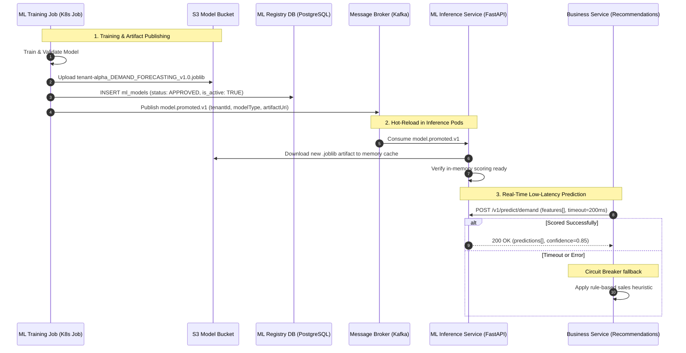
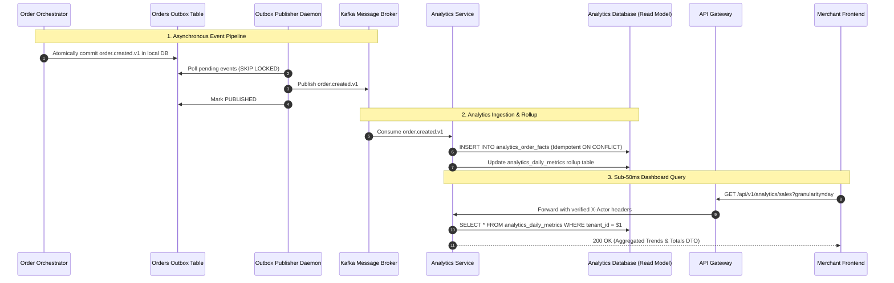
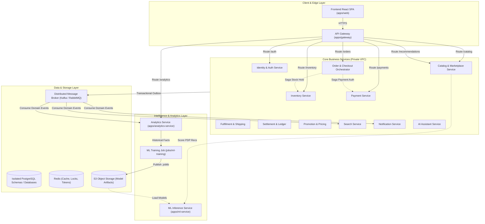

# TARGET ARCHITECTURE AND DEPLOYMENT DESIGN

> **Document Status:** Authoritative Target Architectural Blueprint  
> **Phase:** Design & Planning (Read-Only Architecture Phase)  
> **Baseline Reference:** Verified against [`CURRENT-MONOLITH-VALIDATED.md`](file:///c:/Users/Abhinav/Documents/Project2/ai-driven-multi-vendor-predictive-ecom-platform/CURRENT-MONOLITH-VALIDATED.md)  
> **Safety Guarantee:** Pure design artifact. Zero application code, migrations, packages, or databases modified.

---

## 1. Architecture Goals

The transition from the validated modular monolith to a distributed microservices platform must achieve the following core objectives:

1. **Decouple the Production Application from Developer-Local ML:**
   - Eliminate all operational dependencies on the root-level `/ml` directory, local Windows file paths, unmanaged Python host environments, and unversioned local `/.ml_artifacts/`.
   - Package ML inference and ML training as containerized, versioned, testable, and independently scalable production units.
2. **Strictly Separate ML Inference, ML Training, and Business Analytics:**
   - **Business Analytics** must operate as an independent read-model service consuming asynchronous domain events, completely isolated from ML execution.
   - **ML Training** must execute as an asynchronous, scheduled or event-driven batch job that never contends for CPU/memory with customer traffic.
   - **ML Inference** must operate as a stateless, low-latency microservice with explicit SLAs and heuristic fallbacks.
3. **Preserve Existing Business Logic and Frontend Compatibility:**
   - All 21 domain contexts, data invariants (e.g., inventory oversell checks, double-entry ledgering), and frontend features (`AnalyticsDashboard.tsx`, `Home.tsx`, `Product.tsx`) must retain their current behavioral contracts.
   - An **API Gateway** layer will present unified `/api/v1/*` routing to the existing React frontend, preventing breaking changes.
4. **Establish Isolated Service and Database Ownership:**
   - Terminate cross-domain raw SQL queries (e.g., `OrderService` deleting from `cart_items`).
   - Replace 49 cross-domain foreign keys with immutable ID references, domain events, and eventual consistency.
   - Transition the in-process hybrid outbox into a distributed message broker architecture.
5. **Enforce Non-Blocking Failure Isolation:**
   - Failures or latency spikes in ML inference or analytics ingestion must **never** block or degrade core commerce paths (Catalog browsing, Cart, Checkout, Order placement, or Payment).

---

## 2. Current Constraints

Empirical verification from `CURRENT-MONOLITH-VALIDATED.md` confirms the following real constraints:

1. **Node ↔ Python IPC Flaws:**
   - [`apps/api/src/modules/analytics-ml/internal/python-runner.ts`](file:///c:/Users/Abhinav/Documents/Project2/ai-driven-multi-vendor-predictive-ecom-platform/apps/api/src/modules/analytics-ml/internal/python-runner.ts#L85) uses `child_process.execFileAsync` to invoke `python ml/train.py` and `python ml/predict.py`.
   - It relies on relative path traversal (`findProjectRoot()`) and unencrypted JSON files written to the OS `tmpdir()`.
2. **Missing CI/CD & Build Packaging for ML:**
   - [`.github/workflows/ci.yml`](file:///c:/Users/Abhinav/Documents/Project2/ai-driven-multi-vendor-predictive-ecom-platform/.github/workflows/ci.yml) configures only Node.js 22. It has zero Python setup, no `pip install -r ml/requirements.txt`, and no ML containerization step.
3. **Local Artifact Proliferation:**
   - `/.ml_artifacts/` contains **231 `.joblib` binaries (83+ MB)** stored on the local developer disk.
   - The database table `ml_models.artifact_path` records absolute/relative local filesystem paths (e.g., `C:\...\.ml_artifacts\tenant-alpha_DEMAND_FORECASTING_v1.joblib`).
4. **Shared Database & Monolithic Transactions:**
   - 46 tables exist inside a single PostgreSQL database (`commerce_db`).
   - [`order-service.ts#L342`](file:///c:/Users/Abhinav/Documents/Project2/ai-driven-multi-vendor-predictive-ecom-platform/apps/api/src/modules/orders/internal/order-service.ts#L342) passes an active transaction handle `tx` to `promotionService.finalizeRedemption(tx, ...)`.
   - [`order-service.ts#L460`](file:///c:/Users/Abhinav/Documents/Project2/ai-driven-multi-vendor-predictive-ecom-platform/apps/api/src/modules/orders/internal/order-service.ts#L460) executes raw SQL across domain lines: `DELETE FROM cart_items WHERE ...`.
5. **Authentication Bottleneck:**
   - [`auth-middleware.ts#L23`](file:///c:/Users/Abhinav/Documents/Project2/ai-driven-multi-vendor-predictive-ecom-platform/apps/api/src/http/auth-middleware.ts#L23) calls `identityService.resolveActiveActor()`, executing a live SQL query on `users`, `tenants`, and `tenant_memberships` on **every authenticated request**.

---

## 3. Target Repository Structure

The target repository organizes applications into deployable units under `/apps`, decoupled jobs under `/jobs`, shared contracts under `/packages`, and cloud infrastructure definitions under `/infrastructure`.

```
/
├── apps/                                 # INDEPENDENTLY DEPLOYABLE APPLICATIONS
│   ├── web/                              # Existing React 18 + Vite Frontend Application
│   │   ├── src/                          # Follows STYLE.md specifications
│   │   ├── package.json
│   │   └── Dockerfile
│   │
│   ├── gateway/                          # API Gateway (Envoy / Fastify Edge Gateway)
│   │   ├── src/                          # Route routing, rate limiting, JWT verification
│   │   ├── package.json
│   │   └── Dockerfile
│   │
│   ├── analytics-service/                # Production Business Analytics Service
│   │   ├── src/
│   │   │   ├── consumers/                # Domain event consumers (Orders, Payments, Shipments)
│   │   │   ├── read-models/              # Daily sales, product metrics, operations aggregates
│   │   │   ├── api/                      # Fastify REST endpoints (/analytics/sales, /products)
│   │   │   └── index.ts
│   │   ├── package.json
│   │   └── Dockerfile
│   │
│   ├── ml-service/                       # Stateless Production ML Inference Service (FastAPI)
│   │   ├── app/
│   │   │   ├── api/                      # REST endpoints (/v1/predict/demand, /stockout, etc.)
│   │   │   ├── engine/                   # Scikit-learn inference loaders, vectorizers
│   │   │   ├── storage/                  # S3/MinIO model artifact caching client
│   │   │   ├── schemas/                  # Pydantic input/output validation models
│   │   │   └── main.py                   # FastAPI application entry point
│   │   ├── requirements.txt              # Production inference dependencies (pinned)
│   │   └── Dockerfile                    # Multi-stage Python 3.11-slim container
│   │
│   └── services/                         # CORE BUSINESS MICROSERVICES (Extracted gradually)
│       ├── identity/                     # Auth, Tenancy, RBAC, Token Management
│       ├── catalog-marketplace/          # Categories, Products, SKUs, Reviews & Seller Listings
│       ├── inventory/                    # Stock balances, CAS reservation holds, movement ledger
│       ├── order-orchestrator/           # Checkout state machine, Orders, Saga coordination
│       ├── payment/                      # Payment intents, Stripe webhooks, refund ledgers
│       ├── fulfillment/                  # Multi-vendor shipments, carrier labels, returns
│       ├── settlement-ledger/            # Double-entry bookkeeping, merchant payout cycles
│       ├── promotion-pricing/            # Coupons, promotion validation, discount distribution
│       ├── search/                       # Derived search projections, double-buffered queries
│       ├── notifications/                # Email (Resend), WhatsApp, Customer preferences
│       └── ai-agent/                     # RAG knowledge base, pgvector chunks, WhatsApp commerce
│
├── jobs/                                 # DECOUPLED ASYNCHRONOUS BATCH & TRAINING WORKERS
│   └── ml-training/                      # ML Training Pipeline & Evaluation Worker
│       ├── src/
│       │   ├── data/                     # Data extraction from analytics, cold-start bootstrap
│       │   ├── features/                 # Feature extraction & transformation pipelines
│       │   ├── models/                   # Model definitions (Forecaster, Risk, Propensity, Anomaly)
│       │   ├── pipeline.py               # Training, cross-validation, evaluation, S3 upload
│       │   └── main.py                   # CLI / K8s Job entry point
│       ├── requirements.txt              # Training dependencies (pandas, scikit-learn, joblib)
│       └── Dockerfile                    # Container for Kubernetes CronJob or batch runner
│
├── packages/                             # SHARED CODE & CONTRACTS (Monorepo Workspaces)
│   ├── event-contracts/                  # Canonical domain event schemas (TypeScript & JSONSchema)
│   ├── logger/                           # Enterprise JSON logging library & correlation context
│   ├── errors/                           # Standard error codes & HTTP response mappings
│   └── tsconfig/                         # Shared TypeScript compiler configurations
│
├── infrastructure/                       # CLOUD & RUNTIME INFRASTRUCTURE MANIFESTS
│   ├── docker/                           # Local docker-compose configurations
│   ├── k8s/                              # Kubernetes manifests / Helm charts per service
│   ├── terraform/                        # Cloud infrastructure (RDS, S3, Kafka, Redis)
│   └── gateway-config/                   # Envoy / Gateway routing configuration
│
├── docs/                                 # Architecture specs and discovery records
├── CURRENT-MONOLITH-VALIDATED.md         # Source-of-truth validated discovery
├── TARGET-ARCHITECTURE-AND-DEPLOYMENT-DESIGN.md # This authoritative document
├── package.json                          # Monorepo root npm workspaces configuration
├── package-lock.json
└── README.md
```

---

## 4. Target Application Boundaries

### Separation of Responsibilities

```
┌─────────────────────────────────────────────────────────────────────────────┐
│                            FRONTEND (apps/web)                              │
│         React 18 SPA consuming unified /api/v1/* through API Gateway        │
└──────────────────────────────────────┬──────────────────────────────────────┘
                                       │
                                       ▼
┌─────────────────────────────────────────────────────────────────────────────┐
│                           API GATEWAY (apps/gateway)                        │
│   Reverse proxy, TLS termination, Rate limiting, Cryptographic JWT verify   │
└──────┬───────────────────────┬─────────────────────────┬────────────────────┘
       │                       │                         │
       ▼                       ▼                         ▼
┌──────────────┐      ┌─────────────────┐       ┌─────────────────┐
│ BUSINESS     │      │ BUSINESS        │       │ ML INFERENCE    │
│ SERVICES     │      │ ANALYTICS       │       │ SERVICE         │
│ (Orders,     │      │ (apps/          │       │ (apps/          │
│ Inventory,   │      │ analytics-      │       │ ml-service)     │
│ Catalog,     │      │ service)        │       │                 │
│ Payment)     │      │                 │       │ Stateless       │
│              │      │ Read-model      │       │ FastAPI runtime │
│ Transactional│      │ facts, daily    │       │ scoring cached  │
│ commerce     │      │ rollups,        │       │ models from S3  │
│ state        │      │ dashboards      │       │                 │
└──────┬───────┘      └────────▲────────┘       └────────▲────────┘
       │                       │                         │
       │ Publish Domain Events │                         │
       ▼                       │                         │ Reads Model Artifacts
┌──────────────────────────────┴────────┐                │
│ DISTRIBUTED MESSAGE BROKER            │                │
│ (Kafka / RabbitMQ via Outbox Relay)   │                │
└──────────────────────────────┬────────┘                │
                               │                         │
                               │ Historical Facts        │
                               ▼                         │
                      ┌─────────────────┐                │
                      │ ML TRAINING     │                │
                      │ BATCH JOB       │                │
                      │ (jobs/          │ Writes Models  │
                      │ ml-training)    ├────────────────┘
                      │                 │
                      │ Scheduled / K8s │
                      │ Job runner      │
                      └─────────────────┘
```

---

## 5. Target Service Boundaries

The 21 monolith modules map into **11 distinct deployable microservices**, plus **1 dedicated Analytics Service**, **1 ML Inference Service**, and **1 Batch Training Job**:

| Target Service / Application | Monolith Modules Consolidated   | Data Ownership (Schema/DB)                                                                                  | Primary Protocol       | Justification                                                                            |
| ---------------------------- | ------------------------------- | ----------------------------------------------------------------------------------------------------------- | ---------------------- | ---------------------------------------------------------------------------------------- |
| **API Gateway**              | Routing from `http/*-routes.ts` | Redis (Rate limits, token blacklist)                                                                        | HTTP/2, TLS            | Single entry point, isolates frontend from internal microservice topology.               |
| **Identity Service**         | `identity`, `security-audit`    | `identity_db` (`users`, `tenants`, `memberships`, `tokens`, `audit_logs`)                                   | REST / Internal gRPC   | High security requirement, token issuance, credential hashing.                           |
| **Catalog & Marketplace**    | `catalog`, `marketplace`        | `catalog_db` (`categories`, `products`, `skus`, `listings`, `reviews`)                                      | REST / gRPC, Outbox    | High read volume; avoids N+1 distributed join between products and vendor offers on PDP. |
| **Inventory Service**        | `inventory`                     | `inventory_db` (`inventory_items`, `reservations`, `movements`)                                             | gRPC, Outbox           | Concurrency write hotspot; handles CAS locks and stock reservation lifecycles.           |
| **Order Orchestrator**       | `cart-checkout`, `orders`       | `orders_db` (`carts`, `cart_items`, `checkout_sessions`, `customer_orders`, `seller_orders`, `order_items`) | REST / gRPC, Outbox    | Coordinates checkout progression, immutable snapshots, and Saga compensation.            |
| **Payment Service**          | `payment`                       | `payment_db` (`intents`, `attempts`, `webhook_events`, `refunds`)                                           | REST, Webhooks, Outbox | PCI boundary, provider tokenization (Stripe), refund ledger.                             |
| **Fulfillment Service**      | `fulfillment`                   | `fulfillment_db` (`shipments`, `items`, `returns`, `carrier_ops`)                                           | REST, Webhooks, Outbox | Carrier integration (Shippo), tracking updates, return workflows.                        |
| **Settlement & Ledger**      | `settlement-ledger`             | `settlement_db` (`accounts`, `adjustments`, `settlements`, `ledger_entries`, `transactions`)                | Outbox Consumer, REST  | Double-entry financial accounting, immutable audit trails.                               |
| **Promotion & Pricing**      | `promotion-pricing`             | `promotions_db` (`promotions`, `coupons`, `redemptions`)                                                    | REST, Outbox           | Coupon validation, multi-vendor discount calculation and attribution.                    |
| **Search Service**           | `search`                        | `search_db` / OpenSearch (`product_projections`, `seller_offers`)                                           | REST, Outbox Consumer  | Derived read model for faceted search and text matching.                                 |
| **Notification Service**     | `notifications`, `price-alerts` | `notifications_db` (`notifications`, `preferences`, `price_watches`)                                        | Outbox Consumer        | Multi-channel delivery (Email, WhatsApp) with retry logic.                               |
| **AI Assistant Service**     | `ai`                            | `ai_db` (`conversations`, `messages`, `knowledge_documents`, `vector_chunks`)                               | REST, Webhooks         | LLM integrations, pgvector semantic search, WhatsApp bot.                                |
| **Analytics Service**        | `analytics`                     | `analytics_db` (`order_facts`, `payment_facts`, `fulfillment_facts`, `daily_metrics`)                       | REST, Outbox Consumer  | Purely derived read model for merchant and admin dashboards.                             |
| **ML Inference Service**     | Part of `analytics-ml`          | Stateless (Reads cached `.joblib` artifacts from S3/MinIO)                                                  | REST / gRPC            | Lightweight scikit-learn scoring engine. Zero database writes.                           |
| **ML Training Job**          | Part of `analytics-ml` + `/ml`  | `ml_registry_db` (`ml_models`, `ml_training_jobs`, `ml_policies`)                                           | Batch CLI / K8s Job    | Asynchronous feature engineering, model fitting, and S3 artifact publishing.             |

---

## 6. Analytics Architecture

### Principles & Data Flow

1. **Ownership:** The Analytics Service owns the `analytics_db` schema containing:
   - Fact tables: `analytics_order_facts`, `analytics_payment_facts`, `analytics_fulfillment_facts`
   - Aggregated metrics: `analytics_daily_metrics`
   - Audit logs: `analytics_rebuild_audit`
2. **Ingestion Mechanism:**
   - Purely event-driven. The Analytics Service subscribes to domain events broadcast over the message broker:
     - `order.created.v1`, `order.status_changed.v1`
     - `payment.succeeded.v1`, `payment.failed.v1`
     - `fulfillment.shipment_status_changed.v1`, `fulfillment.return_status_changed.v1`
   - Events are written idempotently to fact tables using the event's `eventId` as a deduplication key (`ON CONFLICT (event_id, ...) DO NOTHING`).
3. **Decoupling from ML:**
   - Analytics provides an internal read-only API or replica database access for the ML Training Job to extract historical feature data (`getProductDailyDemandHistory`, `getInventoryVelocitySignals`).
   - Analytics **never** executes ML predictions or blocks on ML training.
4. **API Serving:**
   - Exposes REST endpoints directly to the API Gateway:
     - `GET /api/v1/analytics/sales?granularity=day`
     - `GET /api/v1/analytics/products?limit=10`
     - `GET /api/v1/analytics/operations`
   - Serves merchant and platform admin dashboards in sub-50ms using pre-aggregated daily rollup tables.

---

## 7. ML Inference Architecture

### Production Inference Engine (`apps/ml-service`)

1. **Technology Stack:**
   - **Runtime:** Python 3.11-slim
   - **Framework:** FastAPI with Uvicorn (ASGI)
   - **Serialization Engine:** `joblib`
   - **Dependencies:** `joblib`, `numpy`, `scikit-learn` (strictly pinned in `requirements.txt`)
2. **Stateless Scoring Contract:**
   - Receives pre-extracted feature vectors or entity IDs over REST/gRPC.
   - Evaluates predictions entirely in-memory using loaded model instances.
   - **Zero Database Writes:** Does not write to PostgreSQL during real-time inference. Returns predictions directly in the HTTP/gRPC response.
3. **Endpoints:**
   - `POST /v1/predict/demand`: Regression score for product sales over a 7-day horizon.
   - `POST /v1/predict/stockout`: Probability score for inventory runout risk.
   - `POST /v1/predict/propensity`: Probability score for customer repeat purchase.
   - `POST /v1/predict/anomaly`: Binary probability for order transaction anomaly/fraud.
   - `GET /health/liveness`: Returns `200 OK` (process alive).
   - `GET /health/readiness`: Returns `200 OK` only after active models are verified in local memory cache.
4. **Cold-Start & Failure Fallback:**
   - If a model artifact is missing or corrupted, the service returns a structured fallback response:
     ```json
     {
       "success": true,
       "predictionValue": 0.0,
       "probability": null,
       "confidence": 0.0,
       "fallbackApplied": true,
       "reason": "MODEL_UNAVAILABLE_FALLBACK"
     }
     ```
   - Calling services (e.g., Recommendations) immediately fall back to rule-based heuristics (e.g., sort by highest gross units sold).

---

## 8. ML Training Architecture

### Decoupled Training Pipeline (`jobs/ml-training`)

1. **Execution Nature:**
   - Completely decoupled from the real-time application.
   - Runs as a **Kubernetes Job** or **AWS ECS Task** triggered by:
     - Nightly cron schedule (e.g., `0 2 * * *`)
     - Automated drift policy threshold (`minNewOrdersThreshold` reached)
     - Manual operator dispatch via admin API
2. **Step-by-Step Training Workflow:**
   ```
   [Step 1: Extract Historical Facts]
     Query analytics_db or replica for last 60 days of sales/inventory signals.
              │
              ▼
   [Step 2: Feature Engineering]
     Execute features.py (calculate lag1, lag7, mean7, velocity, days-of-supply).
              │
              ▼
   [Step 3: Train / Validate / Test Split]
     Fit scikit-learn model with deterministic random seed.
              │
              ▼
   [Step 4: Acceptance Evaluation]
     Evaluate test metrics against acceptance thresholds:
     - DEMAND_FORECASTING: test_rmse <= maxAcceptableRmse (100.0)
     - CLASSIFIERS: test_accuracy >= minAcceptableAccuracy (0.50)
              │
              ▼
   [Step 5: Artifact Packaging & Cloud Upload]
     Serialize accepted model to .joblib binary.
     Upload to Object Storage: s3://models-bucket/{tenantId}/{modelType}/{version}.joblib
              │
              ▼
   [Step 6: Registry Update & Promotion]
     Register model record in ml_registry_db with status 'APPROVED'.
     Atomically update is_active = TRUE for the tenant and modelType.
              │
              ▼
   [Step 7: Broadcast Promotion Event]
     Publish model.promoted.v1 event over message broker.
     apps/ml-service instances receive event and hot-reload model artifact from S3.
   ```

---

## 9. Model Artifact Architecture

### Centralized Object Storage Model

Local disk storage (`/.ml_artifacts/`) is strictly prohibited in production.

1. **Storage Provider:**
   - AWS S3, Google Cloud Storage, or MinIO (local dev/staging).
2. **Canonical Artifact Naming & URI Convention:**
   ```
   s3://commerce-ml-artifacts/{tenant_id}/{model_type}/{version}_{commit_hash}.joblib

   Example:
   s3://commerce-ml-artifacts/tenant-alpha/DEMAND_FORECASTING/v1.2.0_7a9f1b.joblib
   ```
3. **Artifact Immutability & Versioning:**
   - Once uploaded, an artifact is immutable. Overwrites are forbidden by bucket policy.
   - S3 bucket versioning enabled for disaster recovery.
4. **Inference Node Local Caching:**
   - When `apps/ml-service` boots or receives a `model.promoted.v1` event, it downloads the artifact from S3 into an ephemeral local memory cache (`/tmp/model_cache`).
   - If the local file already exists and matches the S3 ETag, the download is skipped.
5. **Rollback Mechanism:**
   - Rolling back a model does not re-upload binaries.
   - The operator calls `POST /api/v1/ml/models/:id/rollback`.
   - The registry updates `is_active = TRUE` for the target historical version and broadcasts `model.promoted.v1`.
   - All running `apps/ml-service` pods download/switch to the designated artifact within 2 seconds.

---

## 10. Frontend / API Gateway Architecture

### Unified Edge Gateway (`apps/gateway`)

```
                                  [Customer Web / Mobile Browser]
                                                 │
                                                 ▼ HTTPS / JSON
                                      ┌─────────────────────┐
                                      │     API GATEWAY     │
                                      │    (apps/gateway)   │
                                      └──────────┬──────────┘
                                                 │
         ┌───────────────────────┬───────────────┼───────────────┬───────────────────────┐
         │ /api/v1/auth/*        │ /api/v1/      │ /api/v1/      │ /api/v1/              │ /api/v1/
         │                       │ products/*    │ orders/*      │ analytics/*           │ ml/*
         ▼                       ▼               ▼               ▼                       ▼
┌──────────────────┐    ┌──────────────────┐ ┌───────────────┐ ┌──────────────────┐ ┌──────────────────┐
│ Identity Service │    │ Catalog & Market │ │ Order Orch.   │ │ Analytics Service│ │ ML Service       │
└──────────────────┘    └──────────────────┘ └───────────────┘ └──────────────────┘ └──────────────────┘
```

1. **Responsibilities:**
   - **Path Routing:** Routes `/api/v1/analytics/*` to `analytics-service`, `/api/v1/ml/*` to `ml-service` or Order Orchestrator, `/api/v1/orders/*` to Order Orchestrator.
   - **Cryptographic JWT Validation:**
     - The Gateway validates the JWT signature using the public key (RS256/Ed25519) of the Identity Service.
     - Checks user revocation status against a local Redis cache.
     - Strips external `X-Actor-*` headers to prevent spoofing.
     - Injects trusted internal headers:
       - `X-Actor-User-Id: usr_123`
       - `X-Actor-Tenant-Id: ten_456`
       - `X-Actor-Role: MERCHANT`
       - `X-Correlation-Id: req_789`
     - Downstream microservices parse these verified headers directly with **zero database queries**.
   - **Rate Limiting:** IP and tenant token buckets enforced via Redis.
   - **CORS & Cookie Handling:** Unified handling of `credentials: true` and refresh tokens.

---

## 11. Data Ownership Principles

In the target microservices architecture:

1. **Private Schema per Service:** Each microservice has exclusive ownership of its database tables. Direct cross-service database access is strictly forbidden by PostgreSQL role permissions.
2. **Asynchronous Cross-Domain Reads:** If Service A needs data from Service B, it either calls Service B's public API or maintains an asynchronous, event-driven read model (CQRS).
3. **Immutable Snapshots on Orders:** Orders snapshot product titles, SKU codes, prices, and shipping addresses at the moment of checkout. Orders never join against the live Catalog database.
4. **Idempotency Keys Everywhere:** All state-changing APIs accept and enforce an `Idempotency-Key` header with deduplication tables in the owning database.

### Target Component Data Ownership

| Component                 | Owns Data (Read/Write)                                     | Reads Foreign Data Via                | Forbidden Actions                                 |
| ------------------------- | ---------------------------------------------------------- | ------------------------------------- | ------------------------------------------------- |
| **Identity Service**      | `users`, `tenants`, `memberships`, `tokens`, `audit_logs`  | None                                  | Storing business orders or product listings       |
| **Catalog & Marketplace** | `categories`, `products`, `skus`, `listings`, `reviews`    | Outbox events (stock updates)         | Querying customer identities directly             |
| **Inventory Service**     | `inventory_items`, `reservations`, `movements`             | Catalog API (validates SKU existence) | Directly mutating orders or carts                 |
| **Order Orchestrator**    | `checkout_sessions`, `orders`, `order_items`               | gRPC calls (Inventory, Payment)       | Executing raw SQL on `cart_items` or `promotions` |
| **Payment Service**       | `payment_intents`, `attempts`, `webhook_events`, `refunds` | External Gateway APIs                 | Querying order item contents                      |
| **Analytics Service**     | `order_facts`, `payment_facts`, `daily_metrics`            | Message Broker (Domain Events)        | Mutating transactional commerce tables            |
| **ML Inference**          | Ephemeral model memory cache                               | S3 Object Storage (Artifacts)         | Direct database connections                       |
| **ML Training Job**       | `ml_models`, `ml_training_jobs`, `ml_policies`             | Analytics DB replica / S3             | Holding locks on transactional tables             |

---

## 12. Event Communication Principles

### Transactional Outbox + Distributed Message Broker

1. **Local Outbox per Service:**
   - Every microservice with transactional side effects maintains its own local `outbox_events` table in its own database schema.
   - When a domain entity is saved, the domain event is committed in the **same local ACID transaction**.
2. **Dedicated Outbox Publisher Relay:**
   - A lightweight background daemon per service polls the local outbox table using `FOR UPDATE SKIP LOCKED`.
   - Dispatches events to the central **Message Broker (Apache Kafka or RabbitMQ)**.
   - Updates status to `PUBLISHED` upon broker acknowledgment.
3. **Consumer Idempotency:**
   - Every event consumer maintains a local `event_consumer_receipts` table with a unique constraint on `(consumer_name, event_id)`.
   - Repeated event deliveries are silently acknowledged and skipped.

---

## 13. Deployment Units

| Deployment Unit                     | Runtime               | Container Base Image | Scaling Metric             | Health Endpoints                            | Target Ports       |
| ----------------------------------- | --------------------- | -------------------- | -------------------------- | ------------------------------------------- | ------------------ |
| `apps/web`                          | Static Assets / Nginx | `nginx:alpine`       | Network egress / CPU       | `GET /health`                               | `80` (HTTP)        |
| `apps/gateway`                      | Node.js / Envoy       | `node:22-alpine`     | Active connections, QPS    | `GET /health/live`, `/health/ready`         | `4000` (HTTP)      |
| `apps/services/catalog-marketplace` | Node.js / Fastify     | `node:22-alpine`     | CPU > 70%, QPS             | `GET /health/live`, `/health/ready`         | `4001` (HTTP/gRPC) |
| `apps/services/inventory`           | Node.js / Fastify     | `node:22-alpine`     | Connection pool, QPS       | `GET /health/live`, `/health/ready`         | `4002` (HTTP/gRPC) |
| `apps/services/order-orchestrator`  | Node.js / Fastify     | `node:22-alpine`     | CPU > 70%, QPS             | `GET /health/live`, `/health/ready`         | `4003` (HTTP/gRPC) |
| `apps/services/payment`             | Node.js / Fastify     | `node:22-alpine`     | CPU > 70%, QPS             | `GET /health/live`, `/health/ready`         | `4004` (HTTP/gRPC) |
| `apps/services/identity`            | Node.js / Fastify     | `node:22-alpine`     | CPU > 70%, QPS             | `GET /health/live`, `/health/ready`         | `4005` (HTTP/gRPC) |
| `apps/analytics-service`            | Node.js / Fastify     | `node:22-alpine`     | Event consumer lag, QPS    | `GET /health/live`, `/health/ready`         | `4010` (HTTP)      |
| `apps/ml-service`                   | Python 3.11 / FastAPI | `python:3.11-slim`   | CPU > 60%, Latency > 150ms | `GET /health/liveness`, `/health/readiness` | `8000` (HTTP)      |
| `jobs/ml-training`                  | Python 3.11 Batch     | `python:3.11-slim`   | Run-to-completion (Batch)  | N/A (Job exit code 0/1)                     | N/A (CLI Job)      |

---

## 14. CI/CD Requirements

The production CI/CD pipeline (GitHub Actions) must enforce independent testing, container image building, and automated deployment:

```
[GitHub Push / Pull Request]
          │
          ├──> 1. Web Pipeline (Node.js 22)
          │    └── npm ci -> npm run lint -> npm test -> docker build (apps/web)
          │
          ├──> 2. Backend Services Pipeline (Node.js 22)
          │    └── npm ci -> vitest run -> docker build (per service)
          │
          ├──> 3. ML Inference Pipeline (Python 3.11)
          │    ├── actions/setup-python (v3.11)
          │    ├── pip install -r apps/ml-service/requirements.txt
          │    ├── pytest apps/ml-service/test/
          │    └── docker build -t commerce-ml-service:v1.0.0 apps/ml-service/
          │
          └──> 4. ML Training Pipeline (Python 3.11)
               ├── pip install -r jobs/ml-training/requirements.txt
               ├── pytest jobs/ml-training/test/
               └── docker build -t commerce-ml-training:v1.0.0 jobs/ml-training/
```

### Key Production Requirement

- **Zero Developer Artifacts in Image Builds:** Container images build entirely from declared code and dependencies in the repository. They **never** mount or copy files from a developer's local workstation.

---

## 15. Failure Isolation

### Critical vs. Non-Critical Path Classification

```
┌─────────────────────────────────────────────────────────────┐
│ CRITICAL BUSINESS PATH (Zero-Downtime Guarantee)            │
│ - Browsing Catalog & Listings                               │
│ - Cart Management                                           │
│ - Checkout Session & Stock Reservations                     │
│ - Order Finalization & Payment Capture                      │
└─────────────────────────────────────────────────────────────┘
                              │ Must NEVER fail if
                              ▼
┌─────────────────────────────────────────────────────────────┐
│ NON-CRITICAL AUXILIARY PATH                                 │
│ - Recommendations (Similar / Trending / Personalized)       │
│ - Predictive Analytics (Demand forecast, stockout alert)    │
│ - Merchant Dashboard Rollup Charts                          │
│ - AI WhatsApp Conversational Bot                            │
└─────────────────────────────────────────────────────────────┘
```

### Failure Handling Matrix

| Component Outage                        | Immediate Impact                    | Failure Handling & Isolation Mechanism                                                                         | Customer Experience Impact                                                              |
| --------------------------------------- | ----------------------------------- | -------------------------------------------------------------------------------------------------------------- | --------------------------------------------------------------------------------------- |
| **ML Inference Service Down**           | Predictions cannot be scored.       | Circuit Breaker trips immediately. Recommendation engine falls back to heuristic sorting (most popular items). | **None.** Customers see standard trending items instead of ML-personalized items.       |
| **ML Inference Latency Spike (>300ms)** | Scoring takes too long.             | Timeout enforced at 200ms. Aborts scoring and returns fallback heuristic response.                             | **None.** Page renders on time without hanging.                                         |
| **Analytics Service Down**              | Dashboard metrics not updated.      | Domain events queue safely in the message broker.                                                              | **None to buyers.** Merchant analytics page displays cached data or a temporary banner. |
| **ML Training Job Fails**               | New model candidate rejected.       | Registry keeps the previously approved model active (`is_active = TRUE`). Error logged to Sentry.              | **None.** Existing active model continues serving predictions.                          |
| **Object Storage (S3) Outage**          | New artifacts cannot be downloaded. | ML Inference nodes continue using already cached local `.joblib` files.                                        | **None.** Scoring continues uninterrupted.                                              |

---

## 16. Observability

1. **Distributed Tracing (W3C TraceContext):**
   - API Gateway generates `traceparent` and `correlationId`.
   - Propagated across all HTTP, gRPC, and message broker event headers.
2. **Structured Logging:**
   - Every service emits JSON logs including `timestamp`, `level`, `service`, `traceId`, `correlationId`, and `tenantId`.
3. **ML-Specific Metrics (Prometheus / OpenTelemetry):**
   - `ml_prediction_requests_total{model_type, status}`
   - `ml_prediction_latency_seconds_bucket{model_type}`
   - `ml_model_accuracy_gauge{model_type, version}`
   - `ml_fallback_invocations_total{reason}`
   - `ml_artifact_download_duration_seconds`
4. **Analytics Metrics:**
   - `analytics_event_ingestion_lag_seconds`
   - `analytics_rebuild_duration_seconds`
   - `analytics_unprocessed_events_total`

---

## 17. Security Boundaries

1. **Private Network VPC Isolation:**
   - Only `apps/web` (public static CDN) and `apps/gateway` (public load balancer) expose public internet ports (80/443).
   - All backend microservices, analytics, ML inference nodes, and databases reside within private subnets with strict Security Groups.
2. **mTLS (Mutual TLS) Service Mesh:**
   - Service-to-service communication within the VPC is encrypted and authenticated via mTLS (Istio / Linkerd).
3. **IAM Principle of Least Privilege:**
   - `apps/ml-service` has IAM read-only access to `s3://commerce-ml-artifacts/`.
   - `jobs/ml-training` has IAM write access to upload new artifacts.
   - Transactional microservices have zero access to the ML S3 bucket.

---

## 18. ML Production Deployment Flow



---

## 19. Analytics Production Deployment Flow



---

## 20. Target Architecture Diagrams

### 20.1 Overall Target Microservices Architecture



---

## 21. Migration Boundaries (What NOT to Do in This Phase)

To preserve system stability and prevent project failure, the following actions are **strictly prohibited** in this design phase:

1. **NO Source Code Movement:** Do not move `/ml` into `/apps/ml` or `/jobs/ml-training` yet.
2. **NO Service Code Extraction:** Do not create new directories under `/apps/services` or refactor Fastify controllers.
3. **NO Database Alterations:** Do not drop foreign keys, alter tables, or create new databases in `commerce_db`.
4. **NO Dependency Changes:** Do not install packages (`npm install`, `pip install`) or modify lockfiles.
5. **NO Docker / CI/CD Modifications:** Do not write Dockerfiles or modify `.github/workflows/ci.yml`.
6. **NO Server Execution:** Do not start or test server runtimes.

This document serves strictly as the **architectural blueprint** to guide future phased implementation tasks.

---

## 22. Risks

| Risk                                  | Impact                                                   | Likelihood | Mitigation Strategy                                                                                                                  |
| ------------------------------------- | -------------------------------------------------------- | ---------- | ------------------------------------------------------------------------------------------------------------------------------------ |
| **Premature Service Extraction**      | Distributed monolith complexity, latency degradation.    | High       | Extract low-risk auxiliary services (Notifications, Analytics, AI) first before touching the transactional core (Orders, Inventory). |
| **Model Drift in Production**         | Suboptimal recommendations or incorrect stockout alerts. | Medium     | Scheduled automated drift evaluation policies (`ml_retraining_policies`) with heuristic fallbacks.                                   |
| **Inference Cold-Start Latency**      | Slow first prediction response on new container pods.    | Medium     | Pre-load active models into memory during container startup (`/health/readiness` probe check).                                       |
| **Dual-Writing Data Inconsistencies** | Drift between monolith and extracted services.           | High       | Transactional Outbox pattern ensures guaranteed at-least-once event delivery; consumer receipts prevent duplicate processing.        |

---

## 23. Decisions Required Before Implementation

Before proceeding to any code or directory refactoring, engineering leadership must confirm:

1. **Target Cloud Platform:** AWS (EKS / RDS / S3 / MSK) vs. GCP (GKE / Cloud SQL / GCS / PubSub) vs. Local Kubernetes.
2. **Message Broker Technology:** Apache Kafka (preferred for high-throughput event streaming) vs. RabbitMQ (preferred for AMQP routing ease).
3. **ML Inference Language/Framework:** Confirm FastAPI + Uvicorn as the target inference standard for scikit-learn models.
4. **API Gateway Platform:** Fastify-based Gateway (shares Node.js stack) vs. Envoy / Kong (industry-standard cloud proxy).

---

## 24. Recommended Next Implementation Phase

### PHASE 1 PROPOSAL: ML Packaging & Containerization Blueprint

Once this design document is reviewed and approved, the immediate next technical milestone should be:

> **Isolate and containerize the ML component as a standalone application under `/apps/ml-service` and batch job under `/jobs/ml-training` with pinned virtual environments and remote artifact S3 storage, without modifying core commerce APIs.**
