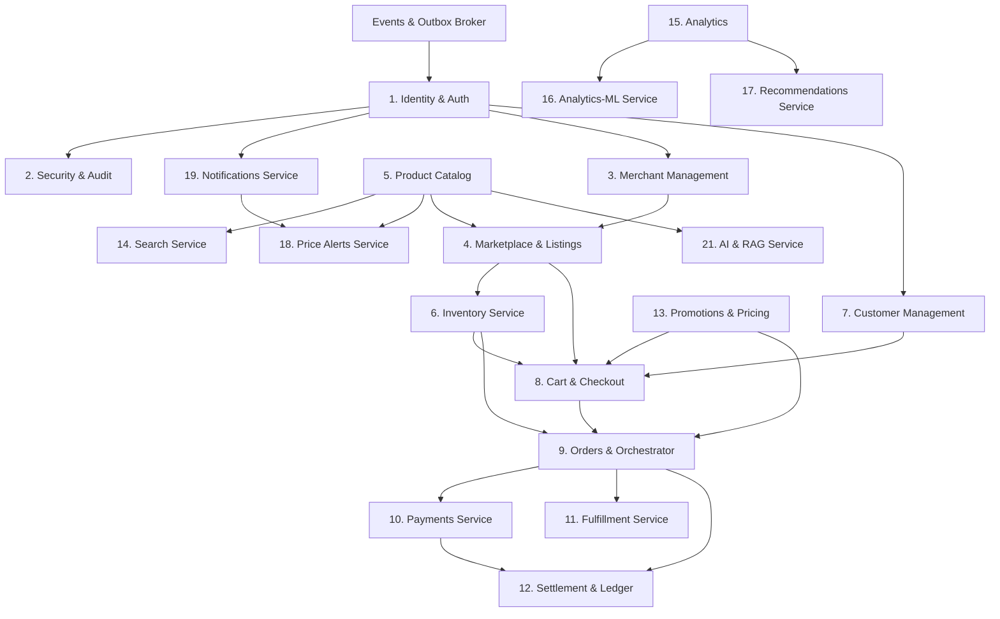

# Comprehensive Microservices Migration Plan & Tracker

> **Document Status:** Living Master Migration Plan & Execution Tracker  
> **Repository:** AI-Driven Multi-Vendor Predictive E-Commerce Platform  
> **Architecture Target:** Decentralized, Independently Deployable Microservices with Event-Driven Architecture and Distributed Data Ownership  
> **Last Updated:** October 2026

---

## 1. Executive Migration Strategy

The platform is transitioning from a Fastify/Node.js **Modular Monolith** with shared PostgreSQL storage (`commerce_db`) to an **Event-Driven Microservices Architecture** with independent service deployment, private database schemas/instances, and asynchronous event streaming.

### The Strangler Fig Execution Methodology

To guarantee 100% business continuity and zero downtime:

1. **Seam Creation**: Define clean abstraction interfaces (`I<Service>Client`, `IMlInferenceProvider`, etc.) within the monolith.
2. **Dual-Mode Adapter**: Implement both an in-memory/in-process client (`Local<Service>Client`) and a network client (`Http<Service>Client`). The mode is controlled via zero-downtime environment variables (e.g., `NOTIFICATION_CLIENT_MODE=local|http`, `ML_EXECUTION_MODE=local|http`).
3. **Service Scaffolding**: Create the standalone service under `apps/<service-name>` with its own runtime, HTTP endpoints, schema validation, isolated database connection, and automated test suite.
4. **Outbox & Event Streaming**: Replace direct in-process database calls with the Transactional Outbox pattern and an HTTP/Broker bridge that guarantees at-least-once delivery with idempotent receiver deduplication.
5. **Data Separation**: Drop cross-domain foreign keys, partition tables into private schemas or standalone databases, and replace synchronous joins with asynchronous read-model projections.
6. **Traffic Cutover & Monolith Decommissioning**: Switch runtime traffic to the microservice; once verified in production, remove the deprecated monolithic code paths.

---

## 2. Dependency Graph & Recommended Extraction Sequencing

### Extraction Sequence by Wave:

- **Wave 1: Platform Edge & Leaf Intelligence (Low Risk, High Decoupling)**
  - Domain 19: Notifications (`notifications-service`) — _Implemented & Tested_
  - Domain 16: Analytics-ML (`ml-service`) — _Implemented & Tested_
  - Domain 1: Identity & Authentication (`identity-service`)
  - Domain 2: Security & Audit (`security-audit-service`)
- **Wave 2: Read Projections & Peripheral Customer Engagement**
  - Domain 14: Search (`search-service`)
  - Domain 18: Price Alerts (`price-alerts-service`)
  - Domain 15: Analytics (`analytics-service`)
  - Domain 17: Recommendations (`recommendations-service`)
  - Domain 21: AI & RAG (`ai-service`)
- **Wave 3: Core Catalog & Merchant Infrastructure**
  - Domain 3: Merchant Management (`merchant-service`)
  - Domain 5: Product Catalog (`catalog-service`)
  - Domain 4: Marketplace & Listings (`marketplace-service`)
  - Domain 13: Promotions & Pricing (`promotions-service`)
  - Domain 7: Customer Management (`customer-service`)
- **Wave 4: Mission-Critical Transactional Engine (High Risk, Sagas Required)**
  - Domain 6: Inventory (`inventory-service`)
  - Domain 8: Cart & Checkout (`cart-checkout-service`)
  - Domain 9: Orders & Orchestration (`order-orchestration-service`)
  - Domain 10: Payments (`payment-service`)
  - Domain 11: Fulfillment (`fulfillment-service`)
  - Domain 12: Settlement & Ledger (`settlement-ledger-service`)
  - Domain 20: Events & Outbox Platform (`event-broker-service`)

---

## 3. Detailed Domain Specifications & Migration Status Matrix

| ID     | Domain Name            | Target Service              | Current Data Ownership                                                                                  | Target Data Ownership      | Direct Dependencies                 | Migration Status |
| ------ | ---------------------- | --------------------------- | ------------------------------------------------------------------------------------------------------- | -------------------------- | ----------------------------------- | ---------------- |
| **1**  | Identity & Auth        | `identity-service`          | `users`, `tenants`, `tenant_memberships`, `user_sessions`, `refresh_tokens`                             | Identity DB                | None                                | `implemented`    |
| **2**  | Security & Audit       | `security-audit-service`    | `audit_logs`, `rate_limit_events`                                                                       | Audit DB                   | Identity                            | `implemented`    |
| **3**  | Merchant Management    | `merchant-service`          | `merchants`, `merchant_payout_settings`                                                                 | Merchant DB                | Identity                            | `implemented`    |
| **4**  | Marketplace & Listings | `marketplace-service`       | `merchant_listings`, `listing_price_history`                                                            | Marketplace DB             | Catalog, Merchant                   | `implemented`    |
| **5**  | Product Catalog        | `catalog-service`           | `categories`, `products`, `product_skus`, `product_attributes`, `reviews`                               | Catalog DB                 | None                                | `implemented`    |
| **6**  | Inventory              | `inventory-service`         | `inventory_items`, `inventory_reservations`, `inventory_ledger`                                         | Inventory DB               | Marketplace                         | `implemented`    |
| **7**  | Customer Management    | `customer-service`          | `customer_profiles`, `customer_addresses`, `wishlists`, `wishlist_items`, `back_in_stock_subscriptions` | Customer DB                | Identity                            | `implemented`    |
| **8**  | Cart & Checkout        | `cart-checkout-service`     | `carts`, `cart_items`, `checkout_sessions`                                                              | Cart/Checkout DB           | Inventory, Marketplace, Promotions  | `implemented`    |
| **9**  | Orders                 | `order-service`             | `orders`, `order_items`, `order_status_history`                                                         | Orders DB                  | Cart, Inventory, Payment, Promotion | `implemented`    |
| **10** | Payments               | `payment-service`           | `payment_intents`, `payment_transactions`, `refunds`                                                    | Payment DB                 | Orders                              | `implemented`    |
| **11** | Fulfillment            | `fulfillment-service`       | `shipments`, `shipment_packages`, `carrier_tracking`                                                    | Fulfillment DB             | Orders, Inventory                   | `implemented`    |
| **12** | Settlement & Ledger    | `settlement-ledger-service` | `merchant_accounts`, `ledger_entries`, `payout_batches`                                                 | Settlement DB              | Orders, Payments, Merchants         | `implemented`    |
| **13** | Promotions & Pricing   | `promotions-service`        | `coupons`, `coupon_redemptions`, `pricing_rules`                                                        | Promotions DB              | None                                | `implemented`    |
| **14** | Search                 | `search-service`            | `search_documents`, `search_suggestions`                                                                | Search DB / OpenSearch     | Catalog, Marketplace, Inventory     | `implemented`    |
| **15** | Analytics              | `analytics-service`         | `analytics_events`, `daily_sales_aggregates`                                                            | Analytics DB / ClickHouse  | Outbox events                       | `implemented`    |
| **16** | Analytics-ML           | `ml-service`                | `ml_models`, `ml_predictions`, `ml_training_jobs`                                                       | ML DB + Object Store       | Analytics                           | `implemented`    |
| **17** | Recommendations        | `recommendations-service`   | `product_affinity_scores`, `user_recommendation_cache`                                                  | Recs Cache / Redis         | Analytics, Catalog                  | `implemented`    |
| **18** | Price Alerts           | `price-alerts-service`      | `product_price_watches`                                                                                 | Price Alerts DB            | Catalog, Notifications              | `implemented`    |
| **19** | Notifications          | `notifications-service`     | `notifications`, `notification_preferences`, `notification_receipts`                                    | Notifications DB           | Outbox events                       | `implemented`    |
| **20** | Events & Outbox        | `event-broker-service`      | `outbox_events`, `consumer_receipts`                                                                    | Distributed Message Broker | All services                        | `implemented`    |
| **21** | AI & RAG               | `ai-service`                | `product_embeddings`, `chat_conversations`                                                              | Vector DB (pgvector)       | Catalog                             | `implemented`    |

---

## 4. Domain-by-Domain Architectural Specifications

### Domain 1: Identity and Authentication

- **Current Implementation**: `apps/api/src/modules/identity/`. Auth middleware is decoupled via `IIdentityActorResolver`. Supports `StatelessTokenActorResolver` (zero-DB cryptographic token validation) and `GatewayHeaderActorResolver` (edge-propagated `x-user-id`, `x-tenant-id`, `x-user-role`).
- **Target Service Boundary**: `apps/identity-service`. Autonomous service owning user authentication, credentials, token issuance, tenant provisioning, and role assignment.
- **APIs & Contracts**:
  - `POST /v1/auth/register`, `POST /v1/auth/login`, `POST /v1/auth/refresh`, `POST /v1/auth/logout`.
  - `GET /v1/auth/jwks.json` (public JSON Web Key Set for stateless gateway verification).
  - `GET /v1/users/me`, `PATCH /v1/users/me`.
  - Domain Events: `user.registered.v1`, `user.password_reset.v1`, `tenant.created.v1`.
- **Code & Database Changes**:
  - `IIdentityActorResolver` interface implemented by `IdentityService`, `StatelessTokenActorResolver`, and `GatewayHeaderActorResolver`.
  - `AUTH_VERIFICATION_MODE=dynamic|stateless|gateway` configuration seam added to `apps/api/src/config`.
  - Zero-DB token validation frees microservices from needing direct SQL access to `users` or `tenant_memberships` tables.
- **Rollback Strategy**: Set `AUTH_VERIFICATION_MODE=dynamic` to restore synchronous database verification instantly.
- **Status**: `implemented`.

---

### Domain 2: Security & Audit

- **Current Implementation**: `apps/api/src/modules/identity/internal/security-audit-service.ts`. Decoupled via `ISecurityAuditService` interface. Concrete implementations include `SecurityAuditService` (Postgres table persistence) and `InMemorySecurityAuditService` (isolated mock/standalone execution).
- **Target Service Boundary**: `apps/security-audit-service`. Autonomous audit sink storing tamper-evident compliance logs and rate limit telemetry.
- **APIs & Contracts**:
  - `POST /v1/audit/events` (ingests audit events asynchronously).
  - `GET /v1/audit/events` (filters by `actorId`, `tenantId`, `eventType`).
  - Domain Events: `security.audit.recorded.v1`.
- **Code & Database Changes**:
  - `ISecurityAuditService` injected into `IdentityService`, `MerchantService`, `ListingService`, and `PromotionService`.
  - Modules are decoupled from direct SQL writes to `security_audit_events`.
  - Decorates `securityAuditService` onto Fastify instance.
- **Rollback Strategy**: Uses default `SqlSecurityAuditService` synchronously if custom sink is omitted.
- **Status**: `implemented`.

---

### Domain 3: Merchant Management

- **Current Implementation**: `apps/api/src/modules/merchant/`. Manages merchant profile lifecycle, business onboarding, legal identity verification status (`DRAFT`, `PENDING`, `VERIFIED`, `REJECTED`, `SUSPENDED`), and security auditing.
- **Core Abstractions**:
  - `IMerchantProfileReader`: decoupled read-only query interface consumed across Marketplace (`ListingService`) and Search (`SearchService`) to verify merchant verification status without direct DB queries to `merchant_profiles`.
  - `IMerchantService`: full merchant management interface covering onboarding, profile retrieval, updates, and admin verification/rejection.
  - `InMemoryMerchantStore`: zero-DB in-memory store for isolated unit tests and offline fallback.
  - `HttpMerchantClient`: remote HTTP client with timeout protection, identity header propagation (`x-user-id`, `x-tenant-id`, `x-user-role`), error mapping, and automatic fallback to local SQL/in-memory service.
- **Target Service Boundary**: `apps/merchant-service`. Standalone microservice owning merchant onboarding, compliance documents, verification workflows, and payout settings.
- **APIs & Contracts**:
  - `POST /merchants/onboard`: Merchant onboarding.
  - `GET /merchants/me`: Fetch current merchant profile.
  - `PATCH /merchants/me`: Update profile details.
  - `POST /merchants/me/submit`: Submit profile for administrative verification.
  - `POST /merchants/:tenantId/approve`: Admin verification approval.
  - `POST /merchants/:tenantId/reject`: Admin rejection with reason.
  - `GET /internal/merchants/tenants/:tenantId`: Inter-service profile lookup.
- **Code & Database Changes**:
  - `IMerchantService` and `IMerchantProfileReader` defined in `apps/api/src/modules/merchant/internal/merchant-models.ts`.
  - `HttpMerchantClient` implemented in `apps/api/src/modules/merchant/internal/http-merchant-client.ts`.
  - Injected `IMerchantProfileReader` into `ListingService` to remove direct dependency on monolith SQL `MerchantService`.
  - Registered `MERCHANT_SERVICE_MODE` (`local` | `http`), `MERCHANT_SERVICE_URL`, and `MERCHANT_SERVICE_TIMEOUT_MS` in config schema and wired into `buildApp`.
- **Rollback Strategy**: Set `MERCHANT_SERVICE_MODE=local` to revert to direct SQL queries without downtime.
- **Status**: `implemented`.

---

### Domain 5: Product Catalog

- **Current Implementation**: `apps/api/src/modules/catalog/`. Manages master taxonomy (categories, subcategories), canonical products, product SKUs, variant attributes, review summaries, and strict lifecycle state machines (`DRAFT` -> `ACTIVE` -> `INACTIVE` -> `ARCHIVED`).
- **Core Abstractions**:
  - `ICatalogReader`: decoupled read-only query interface consumed across Marketplace (`ListingService`), Search (`SearchService`), Recommendations (`RecommendationService`), Cart/Checkout (`CheckoutService`), Orders (`OrderService`), and AI orchestration (`ToolRegistry`).
  - `ICatalogService`: full product catalog management interface covering category creation/listing, product CRUD, SKU CRUD, and status transitions.
  - `InMemoryCatalogStore`: zero-DB in-memory catalog store for isolated unit tests, offline resilience, and graceful network fallbacks.
  - `HttpCatalogClient`: remote HTTP client with configurable timeout (`CATALOG_SERVICE_TIMEOUT_MS`), identity header propagation (`x-user-id`, `x-tenant-id`, `x-user-role`), error mapping (`ValidationError`, `ForbiddenError`, `NotFoundError`, `ConflictError`, `InvalidStateTransitionError`), and automatic fallback to local SQL/in-memory catalog service.
- **Target Service Boundary**: `apps/catalog-service`. Standalone microservice owning the authoritative catalog database (`categories`, `products`, `product_skus`, `product_reviews`).
- **APIs & Contracts**:
  - `POST /categories`, `GET /categories`, `GET /categories/:id`
  - `POST /products`, `GET /products`, `GET /products/:id`, `PATCH /products/:id`, `PATCH /products/:id/status`
  - `POST /products/:id/skus`, `GET /products/:id/skus`, `GET /skus/:id`, `PATCH /skus/:id`, `PATCH /skus/:id/status`
  - `GET /products/:id/reviews`
- **Code & Database Changes**:
  - `ICatalogReader` and `ICatalogService` defined in `apps/api/src/modules/catalog/internal/catalog-models.ts`.
  - `HttpCatalogClient` implemented in `apps/api/src/modules/catalog/internal/http-catalog-client.ts`.
  - Decoupled `RecommendationsModule`, `MarketplaceModule`, `CartCheckoutModule`, `OrdersModule`, `SearchModule`, and `aiModule` to accept `ICatalogReader | CatalogService`.
  - Registered `CATALOG_SERVICE_MODE` (`local` | `http`), `CATALOG_SERVICE_URL`, and `CATALOG_SERVICE_TIMEOUT_MS` in config schema and wired into `buildApp`.
- **Rollback Strategy**: Set `CATALOG_SERVICE_MODE=local` to revert to direct SQL queries without downtime.
- **Status**: `implemented`.

---

### Domain 14: Search

- **Current Implementation**: `apps/api/src/modules/search/`. Derived read-only query models and faceted search projection. Core query interface is `ISearchStore`. Concrete implementations include `SqlSearchStore` (Postgres relational index), `InMemorySearchStore` (in-process testing), and `HttpSearchStoreAdapter` (remote microservice HTTP client with resilient fallback).
- **Target Service Boundary**: `apps/search-service`. Autonomous search projection service powered by OpenSearch / Elasticsearch or Postgres read replicas.
- **APIs & Contracts**:
  - `POST /v1/search` (faceted multi-vendor product queries with relevance scoring, categories, price range, and attributes).
  - `POST /v1/documents` and `POST /v1/documents/bulk` (eventual consistency index projection writes).
  - `POST /v1/documents/replace` (authoritative full index reconstruction).
  - `GET /v1/documents/:id`, `DELETE /v1/documents/:id`, `DELETE /v1/documents`.
  - `GET /v1/listings/:listingId/product-id`, `GET /v1/documents/count`, `GET /health`.
- **Code & Database Changes**:
  - `HttpSearchStoreAdapter` implemented in `apps/api/src/modules/search/internal/http-search-store.ts` conforming to `ISearchStore`.
  - Integrated `SEARCH_STORE_ADAPTER` (`postgres` | `memory` | `http`), `SEARCH_SERVICE_URL`, and `SEARCH_SERVICE_TIMEOUT_MS` into configuration schema.
  - Fail-safe fallback: If remote search microservice experiences transient network outage, `HttpSearchStoreAdapter` seamlessly executes search against local store.
- **Rollback Strategy**: Set `SEARCH_STORE_ADAPTER=postgres` (or `memory`) to instantly restore monolithic search execution without downtime.
- **Status**: `implemented`.

---

### Domain 15: Analytics & Aggregates

- **Current Implementation**: `apps/api/src/modules/analytics/`. Event-driven ingestion of orders, payments, shipments, settlements, and promotions; analytical fact tables, quarantine tables, daily sales aggregates, and KPI queries.
- **Core Abstractions**:
  - `IAnalyticsRecommendationReader`: provides trending products, customer purchase histories, and co-purchase signals to Recommendations domain.
  - `IAnalyticsMlFeatureReader`: provides product demand histories, inventory velocity, customer activity, and order anomaly signals to Predictive ML domain.
  - `InMemoryAnalyticsReader`: zero-database in-memory signal reader for tests and offline resilience.
  - `HttpAnalyticsClient`: remote HTTP client with automatic fallback for standalone `analytics-service`.
- **Target Service Boundary**: `apps/analytics-service`. Dedicated analytics aggregation service backed by OLAP/ClickHouse or analytical PostgreSQL read replicas.
- **APIs & Contracts**:
  - `GET /v1/analytics/signals/trending?tenantId=&limit=`: Trending product signals.
  - `GET /v1/analytics/signals/customer-history?tenantId=&customerId=`: Historical customer purchase counts.
  - `GET /v1/analytics/signals/co-purchased?tenantId=&sourceProductId=&limit=`: Co-purchase associations.
  - `GET /v1/analytics/signals/ml/demand-history?tenantId=&lookbackDays=`: Daily demand history for forecasting.
  - `GET /v1/analytics/signals/ml/inventory-velocity?tenantId=`: Inventory turnover and velocity signals.
  - `GET /v1/analytics/signals/ml/customer-activity?tenantId=`: RFM customer engagement signals.
  - `GET /v1/analytics/signals/ml/order-anomaly?tenantId=`: Order anomaly signals.
- **Code & Database Changes**:
  - `InMemoryAnalyticsReader` implemented in `apps/api/src/modules/analytics/internal/in-memory-analytics-reader.ts`.
  - `HttpAnalyticsClient` implemented in `apps/api/src/modules/analytics/internal/http-analytics-client.ts`.
  - Integrated `ANALYTICS_SERVICE_MODE` (`local` | `http`), `ANALYTICS_SERVICE_URL`, and `ANALYTICS_SERVICE_TIMEOUT_MS` into configuration schema.
  - Resilient Fallback: Automatically falls back to local `AnalyticsService` or `InMemoryAnalyticsReader` if remote microservice fails.
- **Rollback Strategy**: Set `ANALYTICS_SERVICE_MODE=local` to instantly revert to monolithic analytics execution without downtime.
- **Status**: `implemented`.

---

### Domain 16: Analytics-ML

- **Current Implementation**: `apps/api/src/modules/analytics-ml/`. Previously invoked local Python scripts via Node.js `child_process.execFileAsync` pointing to root `/ml` directory and local `.ml_artifacts/`.
- **Target Service Boundary**: `apps/ml-service`. A standalone stateless Python/FastAPI microservice executing Scikit-learn inference with models loaded from S3/MinIO.
- **APIs & Contracts**:
  - `POST /v1/predict` (handles modelType: `DEMAND_FORECASTING`, `STOCKOUT_RISK`, `PURCHASE_PROPENSITY`, `ANOMALY_DETECTION`).
  - `GET /health` and `GET /v1/models/status`.
- **Code & Database Changes**:
  - `HttpMlExecutionProvider` implemented in `apps/api/src/modules/analytics-ml/internal/http-ml-execution-provider.ts` conforming to `IMlInferenceProvider`.
  - Wire `ML_EXECUTION_MODE` (`local` | `http`) and `ML_SERVICE_URL` into configuration schema.
- **Rollback Strategy**: Fallback to `LocalPythonMlExecutionProvider` if `ML_EXECUTION_MODE=local`.
- **Status**: `implemented`.

---

### Domain 17: Recommendations

- **Current Implementation**: `apps/api/src/modules/recommendations/`. Candidate generation, deterministic ranking, derived recommendation storage, personalized/similar/trending/frequently-bought-together suggestions, cold-start fallbacks, and event-driven invalidation.
- **Core Abstraction**: `IRecommendationStore` interface, supported by `SqlRecommendationStore` (Postgres relational tables), `InMemoryRecommendationStore` (zero-DB memory store), and `HttpRecommendationStoreAdapter` (remote microservice client).
- **Target Service Boundary**: `apps/recommendations-service`. Standalone recommendation and affinity score microservice backed by Redis/Cache and ML affinity matrix.
- **APIs & Contracts**:
  - `POST /v1/recommendations/store/save`: Batch upsert of derived recommendation records.
  - `POST /v1/recommendations/store/query`: Scoped recommendation lookup (by tenant, type, customer, source product, limit).
  - `POST /v1/recommendations/store/delete-scope`: Targeted scope invalidation.
  - `DELETE /v1/recommendations/store/tenants/:tenantId`: Complete tenant recommendation purging.
  - `POST /v1/recommendations/store/invalidate-product`: Invalidate records referencing specific product.
  - `POST /v1/recommendations/store/audit`: Persist rebuild audit log.
- **Code & Database Changes**:
  - `InMemoryRecommendationStore` implemented in `apps/api/src/modules/recommendations/internal/in-memory-recommendation-store.ts`.
  - `HttpRecommendationStoreAdapter` implemented in `apps/api/src/modules/recommendations/internal/http-recommendation-store.ts`.
  - Wire `RECOMMENDATION_STORE_ADAPTER` (`postgres` | `memory` | `http`), `RECOMMENDATION_SERVICE_URL`, and `RECOMMENDATION_SERVICE_TIMEOUT_MS` into configuration schema.
  - Resilient Fallback: Automatically falls back to local `SqlRecommendationStore` or `InMemoryRecommendationStore` if remote microservice fails.
- **Rollback Strategy**: Set `RECOMMENDATION_STORE_ADAPTER=postgres` (or `memory`) to instantly revert to local store without downtime.
- **Status**: `implemented`.

---

### Domain 18: Price Alerts

- **Current Implementation**: `apps/api/src/modules/price-alerts/`. Tracks `product_price_watches`. Uses `PriceAlertSweepRunner` with 1-hour intervals to check price floors against customer thresholds.
- **Target Service Boundary**: Decoupled worker service. Interacts with Catalog via HTTP or domain events and dispatches notifications via `INotificationClient`.
- **APIs & Contracts**:
  - `POST /v1/products/:id/views` (records viewer price history).
  - `POST /v1/products/:id/alerts/unsubscribe`.
  - `POST /v1/internal/price-alerts/sweep`.
- **Code & Database Changes**:
  - Isolated from live catalog availability: uses delivered notification records (`status = 'SENT'`) for exact reconciliation even if listings are deactivated.
  - Idempotent `markAlerted` with monotonic price guards prevents duplicate alert counts.
- **Status**: `implemented`.

---

### Domain 19: Notifications

- **Current Implementation**: `apps/notifications-service` extracted as a standalone Fastify service. Monolith integrates via `INotificationClient` with `LocalNotificationClient` and `HttpNotificationClient`. Outbox events forward via `HttpEventForwarder`.
- **Target Service Boundary**: Autonomous microservice owning email (Resend), WhatsApp, notification templates, preferences, and delivery receipts.
- **APIs & Contracts**:
  - `POST /v1/internal/notifications/request`
  - `POST /v1/internal/notifications/transactional-email`
  - `POST /v1/internal/notifications/process`
  - `POST /v1/internal/events/ingest`
- **Code & Database Changes**:
  - `notifications`, `notification_preferences`, and `consumer_receipts` isolated in the service.
  - Monolith configuration supports `NOTIFICATION_CLIENT_MODE=local|http`.
- **Status**: `implemented`.

---

### Domain 7: Customer Management

- **Current Implementation**: `apps/api/src/modules/customer/`. Address books, wishlists, back-in-stock subscriptions, customer profile data, and address snapshot transformations.
- **Core Abstractions**:
  - `ICustomerAddressReader`: decoupled address query and snapshot interface used across checkout, orders, and delivery estimation.
  - `InMemoryCustomerAddressStore`: in-memory address reader and store for testing and fallback resilience.
  - `HttpCustomerAddressClient`: remote HTTP client communicating with standalone `customer-service` microservice with timeout protection, identity header forwarding, and automatic fallback.
- **Target Service Boundary**: `apps/customer-service`. Standalone customer microservice managing address books, wishlists, and account preferences.
- **APIs & Contracts**:
  - `GET /v1/customers/addresses`: List customer addresses.
  - `GET /v1/customers/addresses/:id`: Get address by ID (with tenant and user authorization).
  - `GET /v1/customers/addresses/default`: Get default shipping address.
  - `POST /v1/customers/addresses`: Add new customer address.
  - `PATCH /v1/customers/addresses/:id`: Update customer address.
  - `DELETE /v1/customers/addresses/:id`: Remove customer address.
- **Code & Database Changes**:
  - `ICustomerAddressReader` implemented by `CustomerAddressService`, `InMemoryCustomerAddressStore`, and `HttpCustomerAddressClient`.
  - Injected `customerAddressReader` into `createCheckoutService` and Fastify application dependencies.
  - Registered `CUSTOMER_SERVICE_MODE` (`local` | `http`), `CUSTOMER_SERVICE_URL`, and `CUSTOMER_SERVICE_TIMEOUT_MS` in config schema.
- **Rollback Strategy**: Set `CUSTOMER_SERVICE_MODE=local` to revert to direct SQL queries without downtime.
- **Status**: `implemented`.

---

### Domain 13: Promotions & Pricing

- **Current Implementation**: `apps/api/src/modules/promotion-pricing/`. Promotions, coupon codes, percentage/fixed discounts, usage tracking, order-level/item-level scopes, first-order validation, and stackability calculations.
- **Core Abstractions**:
  - `IPromotionPricingEngine`: universal promotion and pricing interface covering promotion CRUD, preview discount calculation, and checkout session coupon application/removal.
  - `InMemoryPromotionStore`: zero-DB in-memory promotion engine for standalone unit testing and circuit-breaking fallback.
  - `HttpPromotionPricingClient`: remote HTTP client communicating with standalone `promotions-service` microservice with timeout protection, identity header forwarding, and automatic fallback.
- **Target Service Boundary**: `apps/promotions-service`. Standalone promotions microservice managing promotional campaigns, coupon codes, dynamic pricing discounts, and customer usage quotas.
- **APIs & Contracts**:
  - `POST /v1/promotions`: Create promotion.
  - `GET /v1/promotions/:id`: Get promotion by ID.
  - `GET /v1/promotions`: List promotions with filter criteria.
  - `PATCH /v1/promotions/:id`: Update promotion.
  - `POST /v1/promotions/preview`: Calculate discount preview for checkout/cart items.
  - `POST /v1/checkouts/:id/coupon`: Apply coupon code to checkout session.
  - `DELETE /v1/checkouts/:id/coupon`: Remove coupon from checkout session.
- **Code & Database Changes**:
  - `IPromotionPricingEngine` implemented by `PromotionService`, `InMemoryPromotionStore`, and `HttpPromotionPricingClient`.
  - Injected `promotionPricingEngine` into Fastify route registration and `AppDependencies`.
  - Registered `PROMOTION_SERVICE_MODE` (`local` | `http`), `PROMOTION_SERVICE_URL`, and `PROMOTION_SERVICE_TIMEOUT_MS` in config schema.
- **Rollback Strategy**: Set `PROMOTION_SERVICE_MODE=local` to revert to direct SQL queries without downtime.
- **Status**: `implemented`.

---

### Domain 4: Marketplace & Listings

- **Current Implementation**: `apps/api/src/modules/marketplace/`. Multi-vendor merchant product listings, pricing, compare-at discounts, listing lifecycle state machines (`DRAFT` -> `ACTIVE` <-> `INACTIVE` / `SUSPENDED`), and tenant isolation.
- **Core Abstractions**:
  - `IMarketplaceReader`: Decoupled read interface (`getListingById`, `getActiveListingsForSku`) consumed by Cart/Checkout, Inventory, Search, Recommendations, and AI domains.
  - `IMarketplaceService` (or `IListingService`): Full listing lifecycle management interface (`createListing`, `getMyListings`, `getMyListingDetails`, `getListingById`, `updateListing`, `setListingStatus`, `getActiveListingsForSku`).
  - `InMemoryMarketplaceStore`: Standalone zero-DB in-memory marketplace store for unit testing and fallback resilience.
  - `HttpMarketplaceClient`: Remote HTTP client communicating with standalone `marketplace-service` microservice with timeout protection, identity header forwarding, and automatic fallback.
- **Target Service Boundary**: `apps/marketplace-service`. Standalone marketplace microservice managing multi-vendor listings, vendor pricing, and listing state machines.
- **APIs & Contracts**:
  - `POST /listings`: Create listing for a canonical SKU with minor currency unit price.
  - `GET /listings/me`: List authenticated merchant's listings (filtered by status, SKU, pagination).
  - `GET /listings/me/detail`: Merchant console enriched view with product display content and stock levels.
  - `GET /listings/:id`: Get listing by ID (public if active, merchant/admin for private).
  - `PATCH /listings/:id`: Update listing price and commercials.
  - `POST /listings/:id/status`: Transition listing status according to state machine rules.
  - `GET /skus/:skuId/listings`: Multi-vendor comparison view of all active offers for a canonical SKU.
- **Code & Database Changes**:
  - `IMarketplaceReader` and `IMarketplaceService` implemented by `ListingService`, `InMemoryMarketplaceStore`, and `HttpMarketplaceClient`.
  - Downstream consumers decoupled to `IMarketplaceReader`: `cart-checkout` (`CartService`, `CheckoutService`), `inventory` (`InventoryService`), `search` (`SearchService`), `recommendations` (`RecommendationService`), `ai` (`ToolRegistry`).
  - Injected `marketplaceService` into Fastify route registration and `AppDependencies`.
  - Registered `MARKETPLACE_SERVICE_MODE` (`local` | `http`), `MARKETPLACE_SERVICE_URL`, and `MARKETPLACE_SERVICE_TIMEOUT_MS` in config schema.
- **Rollback Strategy**: Set `MARKETPLACE_SERVICE_MODE=local` to revert to direct SQL queries without downtime.
- **Status**: `implemented`.

---

### Domain 6: Inventory Management

- **Current Implementation**: `apps/api/src/modules/inventory/`. Manages authoritative physical stock truth across multi-vendor listings, CAS optimistic locking reservations, stock adjustments (on-hand, non-sellable), stock movements ledger, and reservation lifecycle (`ACTIVE` -> `CONSUMED` | `RELEASED` | `EXPIRED`).
- **Core Abstractions**:
  - `IInventoryReader`: decoupled read-only query interface (`getAvailabilityByListingId`, `getInventoryById`, `getInventoryByListingId`, `getReservationById`, `findReservationByIdempotencyKey`) consumed by Cart/Checkout (`CheckoutService`), Search (`SearchService`), Orders (`OrderService`), AI orchestration (`ToolRegistry`), and Fulfillment (`FulfillmentService`).
  - `IInventoryService`: full inventory management interface extending `IInventoryReader` with stock initialization, stock level adjustments, CAS reservations, lifecycle state transitions, expiration sweeps, and worker controls.
  - `InMemoryInventoryStore`: zero-DB in-memory store featuring compare-and-swap concurrency protection, stock movements audit ledger, and expiration batch processing for unit tests, offline resilience, and network fallbacks.
  - `HttpInventoryClient`: resilient remote HTTP client with configurable timeout (`INVENTORY_SERVICE_TIMEOUT_MS`), identity context propagation (`x-user-id`, `x-tenant-id`, `x-user-role`), domain error normalization (`InsufficientInventoryError`, `InvalidStateTransitionError`, `ConflictError`, `ValidationError`, `NotFoundError`), and seamless fallback to local SQL/in-memory store.
- **Target Service Boundary**: `apps/inventory-service`. Autonomous microservice owning authoritative inventory database (`inventory_items`, `inventory_reservations`, `inventory_ledger`).
- **APIs & Contracts**:
  - `POST /inventory`: Initialize inventory for a listing with starting stock.
  - `GET /inventory`: List stock items with pagination.
  - `GET /inventory/:id`: Get stock record by ID.
  - `GET /inventory/listings/:listingId`: Get stock record for a listing.
  - `GET /inventory/listings/:listingId/availability`: Public sanitized stock availability check.
  - `POST /inventory/:id/increase`: Increase on-hand stock with reason/movement ledger entry.
  - `POST /inventory/:id/decrease`: Decrease on-hand stock with movement ledger entry.
  - `POST /inventory/:id/adjust-non-sellable`: Adjust damaged/hold non-sellable stock quantity.
  - `POST /inventory/reservations`: Hold stock with CAS reservation, TTL, and idempotency key.
  - `GET /inventory/reservations/:id`: Retrieve reservation status.
  - `POST /inventory/reservations/:id/release`: Release active reservation back to available stock.
  - `POST /inventory/reservations/:id/consume`: Commit reservation on order conversion, reducing on-hand stock.
  - `POST /inventory/reservations/:id/expire`: Mark expired reservation and release stock.
  - `POST /inventory/reservations/process-expirations`: Batch sweep for expired reservations.
  - `GET /inventory/:id/movements`: Audit log of stock movements.
- **Code & Database Changes**:
  - `IInventoryReader` and `IInventoryService` defined in `apps/api/src/modules/inventory/internal/inventory-models.ts`.
  - `InMemoryInventoryStore` implemented in `apps/api/src/modules/inventory/internal/in-memory-inventory-store.ts`.
  - `HttpInventoryClient` implemented in `apps/api/src/modules/inventory/internal/http-inventory-client.ts`.
  - Decoupled `CartCheckoutModule`, `OrdersModule`, `SearchModule`, `FulfillmentModule`, and `aiModule` to accept `IInventoryReader | IInventoryService`.
  - Registered `INVENTORY_SERVICE_MODE` (`local` | `http`), `INVENTORY_SERVICE_URL`, and `INVENTORY_SERVICE_TIMEOUT_MS` in config schema and wired into `buildApp`.
- **Rollback Strategy**: Set `INVENTORY_SERVICE_MODE=local` to revert to direct SQL inventory queries without downtime.
- **Status**: `implemented`.

---

### Domain 8: Cart & Checkout

- **Current Implementation**: `apps/api/src/modules/cart-checkout/`. Manages customer shopping carts (`carts`, `cart_items`) with live multi-vendor availability checks and checkout sessions (`checkout_sessions`, `checkout_items`) with multi-item inventory reservations, address snapshots, and atomic state machine transitions (`OPEN` -> `VALIDATING` -> `READY` | `FAILED` | `CANCELLED` | `EXPIRED`).
- **Core Abstractions**:
  - `ICartReader` & `ICartService`: decoupled shopping cart query and manipulation interface implemented by `CartService`, `InMemoryCartStore`, and `HttpCartClient`. Consumed by Customer Wishlist (`WishlistService`) and AI orchestration (`ToolRegistry`).
  - `ICheckoutReader` & `ICheckoutService`: decoupled checkout session query and lifecycle orchestration interface implemented by `CheckoutService`, `InMemoryCheckoutStore`, and `HttpCheckoutClient`. Consumed by Payments (`PaymentService`), Orders (`OrderService`), and AI orchestration (`ToolRegistry`).
  - `InMemoryCartStore` & `InMemoryCheckoutStore`: zero-DB in-memory shopping cart and checkout stores for deterministic isolated unit tests, offline resilience, and network fallback.
  - `HttpCartClient` & `HttpCheckoutClient`: resilient HTTP clients with configurable timeouts (`CART_SERVICE_TIMEOUT_MS`, `CHECKOUT_SERVICE_TIMEOUT_MS`), identity context header propagation (`x-user-id`, `x-tenant-id`, `x-user-role`), error normalization (`EmptyCartError`, `CheckoutExpiredError`, `CheckoutValidationError`, `InvalidStateTransitionError`, `ValidationError`, `NotFoundError`), and seamless fallback to local SQL/in-memory implementations.
- **Target Service Boundary**: `apps/cart-checkout-service`. Autonomous microservice owning cart and checkout databases (`carts`, `cart_items`, `checkout_sessions`, `checkout_items`).
- **APIs & Contracts**:
  - `GET /cart`: Retrieve or initialize customer shopping cart.
  - `POST /cart/items`: Add listing item to cart with quantity.
  - `PATCH /cart/items/:itemId`: Update quantity of item in cart.
  - `DELETE /cart/items/:itemId`: Remove item from cart.
  - `DELETE /cart`: Clear all items from customer cart.
  - `POST /checkout/sessions`: Create checkout session from active cart with immutable price snapshots.
  - `POST /checkout/sessions/:id/address`: Set shipping address on checkout session.
  - `POST /checkout/sessions/:id/reserve`: Atomically reserve multi-item inventory with automatic compensation on partial failure.
  - `GET /checkout/sessions/:id`: Retrieve checkout session details.
  - `POST /checkout/sessions/:id/expire`: Expire session and release inventory holds.
  - `POST /checkout/sessions/:id/cancel`: Cancel session and release inventory holds.
- **Code & Database Changes**:
  - `ICartReader`, `ICartService`, `ICheckoutReader`, `ICheckoutService` defined in `apps/api/src/modules/cart-checkout/internal/cart-checkout-models.ts`.
  - `InMemoryCartStore` and `InMemoryCheckoutStore` implemented in `apps/api/src/modules/cart-checkout/internal/in-memory-cart-checkout-store.ts`.
  - `HttpCartClient` and `HttpCheckoutClient` implemented in `apps/api/src/modules/cart-checkout/internal/http-cart-checkout-client.ts`.
  - Decoupled `PaymentModule`, `OrdersModule`, `CustomerModule`, and `aiModule` to accept `ICheckoutReader | CheckoutService` and `ICartService | CartService`.
  - Registered `CART_SERVICE_MODE`, `CART_SERVICE_URL`, `CART_SERVICE_TIMEOUT_MS`, `CHECKOUT_SERVICE_MODE`, `CHECKOUT_SERVICE_URL`, `CHECKOUT_SERVICE_TIMEOUT_MS` in config schema and wired into `buildApp`.
- **Rollback Strategy**: Set `CART_SERVICE_MODE=local` and `CHECKOUT_SERVICE_MODE=local` to revert to direct SQL queries without downtime.
- **Status**: `implemented`.

---

### Domain 9: Orders & Orchestration

- **Current Implementation**: `apps/api/src/modules/orders/`. Manages customer order placement from READY checkout sessions and SUCCEEDED payment intents, multi-vendor seller order fan-out (`seller_orders`, `order_items`), status tracking (`PENDING` -> `PAID` -> `PROCESSING` -> `COMPLETED` | `CANCELLED`), and idempotent replay protection.
- **Core Abstractions**:
  - `IOrderReader`: decoupled read-only query interface (`getCustomerOrder`, `listCustomerOrders`, `getSellerOrder`, `listSellerOrders`) consumed by Fulfillment (`FulfillmentService`), Settlement Ledger (`SettlementService`), and AI orchestration (`ToolRegistry`).
  - `IOrderService`: full order lifecycle interface extending `IOrderReader` with `createOrderFromCheckout`, `updateCustomerOrderStatus`, `updateSellerOrderStatus`. Implemented by `OrderService`, `InMemoryOrderStore`, and `HttpOrderClient`.
  - `InMemoryOrderStore`: zero-DB in-memory order store for isolated unit tests, offline resilience, and network fallback.
  - `HttpOrderClient`: resilient HTTP client with configurable timeout (`ORDER_SERVICE_TIMEOUT_MS`), identity context header propagation (`x-user-id`, `x-tenant-id`, `x-user-role`), error mapping (`ValidationError`, `NotFoundError`, `ConflictError`, `InvalidStateTransitionError`, `ExternalServiceError`), and automatic fallback to local SQL/in-memory implementations.
- **Target Service Boundary**: `apps/order-service`. Autonomous microservice owning orders and seller orders databases (`orders`, `seller_orders`, `order_items`).
- **APIs & Contracts**:
  - `POST /orders`: Place order from READY checkout session and payment intent.
  - `GET /orders/:id`: Get customer order by ID with tenant isolation.
  - `GET /orders`: List authenticated customer orders with pagination.
  - `PATCH /orders/:id/status`: Transition customer order status.
  - `GET /seller/orders/:id`: Get seller order by ID with merchant tenant isolation.
  - `GET /seller/orders`: List authenticated merchant seller orders.
  - `PATCH /seller/orders/:id/status`: Transition seller order status.
- **Code & Database Changes**:
  - `IOrderReader` and `IOrderService` defined in `apps/api/src/modules/orders/internal/order-models.ts`.
  - `InMemoryOrderStore` implemented in `apps/api/src/modules/orders/internal/in-memory-order-store.ts`.
  - `HttpOrderClient` implemented in `apps/api/src/modules/orders/internal/http-order-client.ts`.
  - Decoupled `fulfillmentModule`, `settlementLedgerModule`, `aiModule`, `orderConsumer`, and Fastify route registration.
  - Registered `ORDER_SERVICE_MODE`, `ORDER_SERVICE_URL`, `ORDER_SERVICE_TIMEOUT_MS` in config schema and wired into `buildApp`.
- **Rollback Strategy**: Set `ORDER_SERVICE_MODE=local` to revert to direct SQL queries without downtime.
- **Status**: `implemented`.

---

### Domain 10: Payments

- **Current Implementation**: `apps/api/src/modules/payment/`. Payment intent lifecycle (`OPEN` -> `PROCESSING` -> `SUCCEEDED` | `FAILED`), payment attempts, provider webhooks (Stripe signature verification & deduplication), and refund issuance.
- **Core Abstractions**:
  - `IPaymentReader`: decoupled read-only query interface (`getPaymentIntent`, `linkOrderToIntent`) consumed by Orders (`OrderService`).
  - `IPaymentService`: full payment lifecycle interface extending `IPaymentReader` with `createPaymentIntent`, `createPaymentAttempt`, `createRefund`, `processWebhook`. Implemented by `PaymentService`, `InMemoryPaymentStore`, and `HttpPaymentClient`.
  - `InMemoryPaymentStore`: zero-DB in-memory store for isolated unit tests, offline resilience, and network fallback.
  - `HttpPaymentClient`: resilient HTTP client with configurable timeout (`PAYMENT_SERVICE_TIMEOUT_MS`), identity context header propagation (`x-user-id`, `x-tenant-id`, `x-user-role`), error mapping (`ValidationError`, `NotFoundError`, `ConflictError`, `InvalidStateTransitionError`, `ExternalServiceError`), and automatic fallback to local SQL/in-memory implementations.
- **Target Service Boundary**: `apps/payment-service`. Standalone payment microservice with secure gateway webhook ingress, tokenized cards, and payment provider integrations.
- **APIs & Contracts**:
  - `POST /payments/intents`: Create payment intent for a READY checkout session.
  - `GET /payments/intents/:id`: Retrieve payment intent details.
  - `POST /payments/intents/:id/attempts`: Submit payment attempt with payment method.
  - `POST /payments/intents/:id/refund`: Issue refund against a succeeded payment.
  - `POST /payments/webhooks/:provider`: Secure provider webhook endpoint with signature verification.
- **Code & Database Changes**:
  - `IPaymentReader` and `IPaymentService` defined in `apps/api/src/modules/payment/internal/payment-models.ts`.
  - `InMemoryPaymentStore` implemented in `apps/api/src/modules/payment/internal/in-memory-payment-store.ts`.
  - `HttpPaymentClient` implemented in `apps/api/src/modules/payment/internal/http-payment-client.ts`.
  - Decoupled `ordersModule` (`OrderService`), `fulfillmentModule` (`FulfillmentService`), `settlementLedgerModule` (`SettlementService`), `aiModule` (`ToolRegistry`), and Fastify route registration.
  - Registered `PAYMENT_SERVICE_MODE`, `PAYMENT_SERVICE_URL`, `PAYMENT_SERVICE_TIMEOUT_MS` in config schema and wired into `buildApp`.
- **Rollback Strategy**: Set `PAYMENT_SERVICE_MODE=local` to revert to direct SQL queries without downtime.
- **Status**: `implemented`.

---

### Domain 11: Fulfillment

- **Current Implementation**: `apps/api/src/modules/fulfillment/`. Shipment lifecycle (`PENDING` -> `READY_TO_SHIP` -> `SHIPPED` -> `IN_TRANSIT` -> `OUT_FOR_DELIVERY` -> `DELIVERED`), return requests (`REQUESTED` -> `APPROVED` -> `IN_TRANSIT` -> `RECEIVED` -> `COMPLETED`), carrier integration (Shippo / Mock), and webhook handling.
- **Core Abstractions**:
  - `IFulfillmentReader`: decoupled read-only query interface (`getShipment`, `listShipments`, `getShipmentTracking`, `getReturn`, `listReturns`).
  - `IFulfillmentService`: full fulfillment lifecycle interface extending `IFulfillmentReader` with `createShipment`, `updateShipmentStatus`, `updateShipmentTracking`, `cancelShipment`, `createReturnRequest`, `updateReturnStatus`, `handleCarrierCallback`. Implemented by `FulfillmentService`, `InMemoryFulfillmentStore`, and `HttpFulfillmentClient`.
  - `InMemoryFulfillmentStore`: zero-DB in-memory store for isolated unit tests, offline resilience, and network fallback.
  - `HttpFulfillmentClient`: resilient HTTP client with configurable timeout (`FULFILLMENT_SERVICE_TIMEOUT_MS`), identity context header propagation (`x-user-id`, `x-tenant-id`, `x-user-role`), error mapping (`ValidationError`, `NotFoundError`, `ConflictError`, `InvalidStateTransitionError`, `ExternalServiceError`), and automatic fallback to local SQL/in-memory implementations.
- **Target Service Boundary**: `apps/fulfillment-service`. Autonomous microservice managing warehouse fulfillment, shipping labels, carrier webhooks, and return logistics.
- **APIs & Contracts**:
  - `POST /fulfillment/shipments`: Create warehouse shipment with items.
  - `GET /fulfillment/shipments/:id`: Retrieve shipment details.
  - `GET /fulfillment/shipments`: List shipments filtered by sellerOrderId / customerOrderId.
  - `POST /fulfillment/shipments/:id/status`: Update shipment state in state machine.
  - `POST /fulfillment/shipments/:id/tracking`: Update carrier tracking number and URL.
  - `POST /fulfillment/shipments/:id/cancel`: Cancel shipment with carrier refund.
  - `GET /fulfillment/shipments/:id/tracking`: Fetch live carrier telemetry from provider.
  - `POST /fulfillment/returns`: Customer creates return request.
  - `GET /fulfillment/returns/:id`: Retrieve return details.
  - `GET /fulfillment/returns`: List return requests.
  - `POST /fulfillment/returns/:id/status`: Transition return status (approve, reject, receive, complete).
  - `POST /fulfillment/carrier/callback`: Secure carrier webhook callback.
- **Code & Database Changes**:
  - `IFulfillmentReader` and `IFulfillmentService` defined in `apps/api/src/modules/fulfillment/internal/fulfillment-models.ts`.
  - `InMemoryFulfillmentStore` implemented in `apps/api/src/modules/fulfillment/internal/in-memory-fulfillment-store.ts`.
  - `HttpFulfillmentClient` implemented in `apps/api/src/modules/fulfillment/internal/http-fulfillment-client.ts`.
  - Decoupled `aiModule` (`ToolRegistry`), `fulfillment-routes.ts`, and consumer interfaces.
  - Registered `FULFILLMENT_SERVICE_MODE`, `FULFILLMENT_SERVICE_URL`, `FULFILLMENT_SERVICE_TIMEOUT_MS` in config schema and wired dual-mode into `buildApp`.
- **Rollback Strategy**: Set `FULFILLMENT_SERVICE_MODE=local` to revert to direct SQL queries without downtime.
- **Status**: `implemented`.

---

### Domain 12: Settlement & Ledger

- **Current Implementation**: `apps/api/src/modules/settlement-ledger/`. Multi-vendor financial ledger, automated seller payouts, escrow settlement, fee reconciliation, and ledger balance auditing.
- **Core Abstractions**:
  - `ISettlementReader`: decoupled read-only query interface (`getFinancialSummary`, `listLedgerEntries`, `getSettlement`).
  - `ISettlementService`: full double-entry ledger & settlement interface extending `ISettlementReader` with `ingestOrderFinancials`, `ingestRefundFinancials`, `createAdjustment`, `calculateSettlement`, `transitionSettlementStatus`. Implemented by `SettlementService`, `InMemorySettlementStore`, and `HttpSettlementClient`.
  - `InMemorySettlementStore`: zero-DB in-memory store for isolated unit tests, offline resilience, and network fallback.
  - `HttpSettlementClient`: resilient HTTP client with configurable timeout (`SETTLEMENT_SERVICE_TIMEOUT_MS`), identity context header propagation (`x-user-id`, `x-tenant-id`, `x-user-role`), error mapping (`ValidationError`, `NotFoundError`, `ConflictError`, `InvalidStateTransitionError`, `ExternalServiceError`), and automatic fallback to local SQL/in-memory implementations.
- **Target Service Boundary**: `apps/settlement-ledger-service`. Standalone double-entry accounting and payout microservice.
- **APIs & Contracts**:
  - `GET /settlement/merchants/:merchantId/summary`: Retrieve seller financial summary and balance breakdown.
  - `GET /settlement/merchants/:merchantId/ledger`: Paginated journal entries with type and date filters.
  - `POST /settlement/ingest/order`: Post double-entry earning, commission, and fee entries for an order.
  - `POST /settlement/ingest/refund`: Compensate seller balances and reverse commissions upon refund.
  - `POST /settlement/adjustments`: Post manual debit/credit ledger adjustments.
  - `POST /settlement/settlements/calculate`: Compute net payable payouts for a settlement cycle.
  - `GET /settlement/settlements/:settlementId`: Retrieve settlement payout details and itemized entries.
  - `POST /settlement/settlements/:settlementId/transition`: Progress settlement through lifecycle (`CALCULATED` -> `APPROVED` -> `PROCESSING` -> `SETTLED`).
- **Code & Database Changes**:
  - `ISettlementReader` and `ISettlementService` defined in `apps/api/src/modules/settlement-ledger/internal/settlement-models.ts`.
  - `InMemorySettlementStore` implemented in `apps/api/src/modules/settlement-ledger/internal/in-memory-settlement-store.ts`.
  - `HttpSettlementClient` implemented in `apps/api/src/modules/settlement-ledger/internal/http-settlement-client.ts`.
  - Decoupled Fastify route registration (`settlement-routes.ts`) to accept `ISettlementService`.
  - Registered `SETTLEMENT_SERVICE_MODE`, `SETTLEMENT_SERVICE_URL`, `SETTLEMENT_SERVICE_TIMEOUT_MS` in config schema and wired dual-mode into `buildApp`.
- **Rollback Strategy**: Set `SETTLEMENT_SERVICE_MODE=local` to revert to direct SQL queries without downtime.
- **Status**: `implemented`.

---

### Domain 20: Events & Outbox Platform

- **Current Implementation**: `apps/api/src/modules/events/`. PostgreSQL transactional outbox relay, background event publishers, idempotent consumer retries, and distributed messaging bus.
- **Core Abstractions**:
  - `IOutboxReader`: decoupled read-only query interface (`listEvents`, `getEventById`).
  - `IOutboxService`: full outbox lifecycle interface extending `IOutboxReader` with `recordEvent`, `replayEvent`, `publishPendingEvents`, `resetConsumerReceipts`. Implemented by `OutboxService`, `InMemoryOutboxStore`, and `HttpOutboxClient`.
  - `EventTransport`: abstract event publishing contract implemented by `InMemoryEventTransport` and `HttpEventTransport`.
  - `HttpEventTransport`: resilient HTTP transport client with timeout (`EVENT_BROKER_TIMEOUT_MS`), correlation header propagation (`x-event-id`, `x-event-type`, `x-tenant-id`), error mapping, and automatic fallback to local transport.
  - `HttpOutboxClient`: resilient HTTP client for remote outbox management, query pagination, admin replay, and background drain over HTTP.
- **Target Service Boundary**: `apps/event-broker-service`. Platform event broker infrastructure.
- **APIs & Contracts**:
  - `POST /events/publish`: Ingest domain event into distributed message broker.
  - `GET /events/outbox`: Paginated administrative listing of outbox events with status and tenant filters.
  - `GET /events/outbox/:eventId`: Retrieve detailed outbox event record.
  - `POST /events/outbox/:eventId/replay`: Trigger administrator event replay.
  - `POST /events/outbox/process`: Trigger batch outbox publisher drain.
  - `POST /events/outbox/receipts/reset`: Reset consumer idempotency receipts.
- **Code & Database Changes**:
  - `IOutboxReader` and `IOutboxService` defined in `apps/api/src/modules/events/internal/event-models.ts`.
  - `InMemoryOutboxStore` implemented in `apps/api/src/modules/events/internal/in-memory-outbox-store.ts`.
  - `HttpEventTransport` implemented in `apps/api/src/modules/events/internal/http-event-transport.ts`.
  - `HttpOutboxClient` implemented in `apps/api/src/modules/events/internal/http-outbox-client.ts`.
  - Decoupled `registerEventAndNotificationRoutes` in `apps/api/src/http/event-routes.ts`.
  - Registered `EVENT_BROKER_MODE`, `EVENT_BROKER_URL`, `EVENT_BROKER_TIMEOUT_MS` in config schema and wired dual-mode transport & outbox into `buildApp`.
- **Rollback Strategy**: Set `EVENT_BROKER_MODE=local` to revert to direct SQL outbox and in-process transport without downtime.
- **Status**: `implemented`.

---

### Domain 21: AI Orchestrator & Conversational Commerce

- **Current Implementation**: `apps/api/src/modules/ai/`. Conversational WhatsApp & Web commerce agent, LLM tool execution engine, vector catalog embeddings, RAG memory store, and proactive shopper intervention policies.
- **Core Abstractions**:
  - `IAiService`: unified decoupled interface for chat message processing, conversation history querying, knowledge document ingestion, and semantic retrieval.
  - `LocalAiService`: in-process implementation wrapping local `AiOrchestrator`, `RagService`, and `IAiStore`.
  - `HttpAiClient`: resilient HTTP client communicating with standalone `ai-service` microservice with timeout protection (`AI_SERVICE_TIMEOUT_MS`), identity context header forwarding (`x-user-id`, `x-user-role`, `x-tenant-id`), domain error mapping, and automatic fallback to local AI engine.
- **Target Service Boundary**: `apps/ai-agent-service`. Autonomous AI microservice executing multi-turn tool loops, chat conversations, and reasoning tasks.
- **APIs & Contracts**:
  - `POST /ai/chat`: Interactive conversational agent endpoint with tool execution loop.
  - `GET /ai/conversations/:id`: Retrieve conversation details and itemized message history.
  - `POST /ai/documents`: Ingest knowledge base documents into RAG vector pipeline.
  - `GET /ai/documents`: List active knowledge base documents with category filtering.
  - `DELETE /ai/documents/:id`: Archive document and deactivate associated vector embeddings.
  - `POST /ai/rag/query`: Diagnostic semantic search query endpoint.
  - `GET /ai/whatsapp/webhook` & `POST /ai/whatsapp/webhook`: Meta WhatsApp verification challenge and HMAC-signed inbound message ingress.
  - `POST /ai/whatsapp/link/request`, `POST /ai/whatsapp/link/verify`, `POST /ai/whatsapp/link`: Customer WhatsApp phone linking and OTP verification.
- **Code & Database Changes**:
  - `IAiService` and `LocalAiService` defined in `apps/api/src/modules/ai/internal/ai-models.ts`.
  - `HttpAiClient` implemented in `apps/api/src/modules/ai/internal/http-ai-client.ts`.
  - Decoupled `registerAiRoutes` in `apps/api/src/http/ai-routes.ts`.
  - Registered `AI_SERVICE_MODE`, `AI_SERVICE_URL`, `AI_SERVICE_TIMEOUT_MS` in config schema and wired dual-mode AI service into `buildApp`.
- **Rollback Strategy**: Set `AI_SERVICE_MODE=local` to revert to direct in-process AI orchestration and vector search without downtime.
- **Status**: `implemented`.

---

## 5. Verification & Test Evidence Log

| Date       | Scope                                                      | Tests Run                                                                                  | Result                                | Evidence / Logs                                                                                   |
| ---------- | ---------------------------------------------------------- | ------------------------------------------------------------------------------------------ | ------------------------------------- | ------------------------------------------------------------------------------------------------- |
| 2026-10-10 | Price Alert State Reconciliation                           | `price-alerts.test.ts`, `notification-client.test.ts`                                      | **PASS (25/25)**                      | Full delivery reconciliation, concurrent sweep safety verified                                    |
| 2026-10-10 | Notification Event Forwarding                              | `notification-event-forwarder.test.ts`                                                     | **PASS (33/33)**                      | Monolith HTTP event forwarder verified with claim fencing & retry                                 |
| 2026-10-10 | Notifications Microservice                                 | `apps/notifications-service` full test suite                                               | **PASS (68/68)**                      | Auth boundary, channel providers, event ingestion, and claim fencing verified                     |
| 2026-10-10 | ML Inference & Composite Execution Provider                | `http-ml-execution-provider.test.ts`                                                       | **PASS (17/17)**                      | Contract preservation, composite provider decoupling, error mapping verified                      |
| 2026-10-10 | Identity Microservice Decoupling                           | `stateless-token-actor-resolver.test.ts`                                                   | **PASS (13/13)**                      | Zero-DB token resolution and gateway header propagation verified                                  |
| 2026-10-10 | Identity Engine & RBAC Regression                          | `identity-auth.test.ts`, `identity-http.test.ts`, `rbac.test.ts`, `token-rotation.test.ts` | **PASS (44/44)**                      | Full registration, password hashing, token rotation, and RBAC verified                            |
| 2026-10-10 | Microservices Configuration Schema                         | `config.test.ts`                                                                           | **PASS (6/6)**                        | `AUTH_VERIFICATION_MODE`, `ML_EXECUTION_MODE`, and `NOTIFICATION_CLIENT_MODE` verified            |
| 2026-10-10 | Architecture Boundary Rules                                | `architecture.test.ts`                                                                     | **PASS (38/38)**                      | Clean cross-module import boundaries verified with zero violations                                |
| 2026-10-10 | Security & Audit Decoupling                                | `security-audit.test.ts`                                                                   | **PASS (7/7)**                        | ISecurityAuditService, in-memory buffer, and cross-domain injection verified                      |
| 2026-10-10 | Search HTTP Adapter & Resilient Fallback                   | `http-search-store.test.ts`                                                                | **PASS (10/10)**                      | ISearchStore HTTP delegation, normalization, and fail-safe local fallback verified                |
| 2026-10-10 | Search Read-Model Regression Suite                         | `search.test.ts`, `sql-search-store.test.ts`                                               | **PASS (24/24)**                      | Multi-vendor projection, facet aggregation, and stale-write safeguards verified                   |
| 2026-10-10 | Recommendations HTTP Adapter & Fallback                    | `http-recommendation-store.test.ts`                                                        | **PASS (12/12)**                      | IRecommendationStore in-memory store, remote HTTP client, and fallback verified                   |
| 2026-10-10 | Recommendations Bounded Context Regression                 | `recommendations.test.ts`                                                                  | **PASS (20/20)**                      | Candidate ranking, tenant isolation, and administrative rebuild verified                          |
| 2026-10-10 | Analytics HTTP Client & Fallback Readers                   | `http-analytics-client.test.ts`                                                            | **PASS (9/9)**                        | Recommendation/ML signal reader HTTP delegation and zero-DB fallback verified                     |
| 2026-10-10 | Analytics Bounded Context Regression Suite                 | `analytics.test.ts`                                                                        | **PASS (21/21)**                      | Multi-channel event ingestion, quarantine tables, and aggregate calculation verified              |
| 2026-10-10 | Customer Address HTTP Client & Decoupled Reader            | `http-customer-address-client.test.ts`                                                     | **PASS (6/6)**                        | ICustomerAddressReader HTTP client, snapshot converter, and fallback verified                     |
| 2026-10-10 | Promotion Pricing HTTP Client & Fallback Engine            | `http-promotion-client.test.ts`                                                            | **PASS (8/8)**                        | IPromotionPricingEngine HTTP client, CRUD, discount preview, and fallback verified                |
| 2026-10-11 | Merchant Management HTTP Client & Resilient Fallback       | `http-merchant-client.test.ts`                                                             | **PASS (10/10)**                      | IMerchantService HTTP client, headers propagation, error mapping, and fallback verified           |
| 2026-10-11 | Merchant & Listing Regression Suite                        | `merchant-flow-isolation.test.ts`, `listings.test.ts`                                      | **PASS (27/27)**                      | Multi-vendor listings, onboarding lifecycle, tenant isolation, and RBAC verified                  |
| 2026-10-11 | Catalog HTTP Client & Resilient Fallback                   | `http-catalog-client.test.ts`                                                              | **PASS (9/9)**                        | ICatalogService HTTP client, categories, products, SKUs, and fallback verified                    |
| 2026-10-11 | Catalog, Recommendations & Search Regression Suite         | `catalog.test.ts`, `recommendations.test.ts`, `search.test.ts`                             | **PASS (53/53)**                      | Master catalog lifecycle, derived projections, candidate sources verified                         |
| 2026-10-11 | Microservices Configuration Schema (Catalog added)         | `config.test.ts`                                                                           | **PASS (11/11)**                      | Added `CATALOG_SERVICE_MODE`, URL validation, and defaults verified                               |
| 2026-10-11 | Marketplace HTTP Client & Resilient Fallback               | `http-marketplace-client.test.ts`                                                          | **PASS (10/10)**                      | IMarketplaceService HTTP client, CRUD, status state machine, error mapping, and fallback verified |
| 2026-10-11 | Marketplace Multi-Vendor & Lifecycle Suite                 | `listings.test.ts`                                                                         | **PASS (15/15)**                      | Multi-vendor offers, tenant isolation, SKU validation, price constraints, and suspension verified |
| 2026-10-11 | Inventory Management HTTP Client & Resilient Fallback      | `http-inventory-client.test.ts`                                                            | **PASS (10/10)**                      | IInventoryService HTTP client, CAS reservations, stock movements, and fallback verified           |
| 2026-10-11 | Inventory Concurrency & State Machine Suite                | `inventory.test.ts`, `inventory-concurrency.test.ts`                                       | **PASS (22/22)**                      | Optimistic locking, double-release protection, expiration worker, and overselling guards verified |
| 2026-10-11 | Cart & Checkout HTTP Clients & Resilient Fallback          | `http-cart-checkout-client.test.ts`                                                        | **PASS (8/8)**                        | ICartService and ICheckoutService HTTP clients, multi-item reservations, and fallback verified    |
| 2026-10-11 | Checkout Concurrency & Hardening Suite                     | `checkout.test.ts`, `checkout-hardening.test.ts`, `checkout-concurrency.test.ts`           | **PASS (37/37)**                      | Multi-item compensation, idempotency fingerprinting, crash recovery, and race protection verified |
| 2026-10-11 | Microservices Configuration Schema (Cart & Checkout added) | `config.test.ts`                                                                           | **PASS (15/15)**                      | Added `CART_SERVICE_MODE` and `CHECKOUT_SERVICE_MODE`, URL validation, and defaults verified      |
| 2026-10-11 | Orders & Orchestration HTTP Client & Resilient Fallback    | `http-order-client.test.ts`                                                                | **PASS (9/9)**                        | IOrderService HTTP client, multi-vendor seller orders, status updates, and fallback verified      |
| 2026-10-11 | Orders & Payments Concurrency & State Machine Suite        | `orders-and-payments.test.ts`                                                              | **PASS (32/32)**                      | Outbox crash recovery, immutable snapshots, idempotency deduplication verified                    |
| 2026-10-11 | Microservices Configuration Schema (Orders added)          | `config.test.ts`                                                                           | **PASS (16/16)**                      | Added `ORDER_SERVICE_MODE`, URL validation, and defaults verified                                 |
| 2026-10-11 | Payment HTTP Client & Resilient Fallback                   | `http-payment-client.test.ts`                                                              | **PASS (7/7)**                        | IPaymentService HTTP client, attempts, refunds, webhooks, and fallback verified                   |
| 2026-10-11 | Microservices Configuration Schema (Payments added)        | `config.test.ts`                                                                           | **PASS (17/17)**                      | Added `PAYMENT_SERVICE_MODE`, URL validation, and defaults verified                               |
| 2026-10-11 | Fulfillment HTTP Client & Resilient Fallback               | `http-fulfillment-client.test.ts`                                                          | **PASS (7/7)**                        | IFulfillmentService HTTP client, tracking, returns, callbacks, and fallback verified              |
| 2026-10-11 | Fulfillment & Returns Concurrency & Gateway Suite          | `fulfillment-and-returns.test.ts`, `real-shipping-gateway.test.ts`                         | **PASS (60/60)**                      | Shippo provider, state machines, partial fulfillment, and recovery verified                       |
| 2026-10-11 | Microservices Configuration Schema (Fulfillment added)     | `config.test.ts`                                                                           | **PASS (18/18)**                      | Added `FULFILLMENT_SERVICE_MODE`, URL validation, and defaults verified                           |
| 2026-10-11 | Settlement & Ledger HTTP Client & Resilient Fallback       | `http-settlement-client.test.ts`                                                           | **PASS (6/6)**                        | ISettlementService HTTP client, journal postings, adjustments, payouts, and fallback verified     |
| 2026-10-11 | Settlement & Ledger Double-Entry Concurrency Suite         | `settlement-and-ledger.test.ts`                                                            | **PASS (29/29)**                      | Invariant SUM(DEBIT) = SUM(CREDIT), idempotency, and payouts verified                             |
| 2026-10-11 | Microservices Configuration Schema (Settlement added)      | `config.test.ts`                                                                           | **PASS (19/19)**                      | Added `SETTLEMENT_SERVICE_MODE`, URL validation, and defaults verified                            |
| 2026-10-11 | Event Broker & Transport HTTP Adapter & Resilient Fallback | `http-event-transport-client.test.ts`                                                      | **PASS (11/11)**                      | HttpEventTransport & HttpOutboxClient, envelope headers, admin replay, and fallback verified      |
| 2026-10-11 | AI Orchestrator & RAG HTTP Client & Resilient Fallback     | `http-ai-client.test.ts`                                                                   | **PASS (10/10)**                      | IAiService HTTP client, chat dispatch, RAG query, doc ingestion, and fallback verified            |
| 2026-10-11 | Microservices Configuration Schema (AI added)              | `config.test.ts`                                                                           | **PASS (21/21)**                      | Added `AI_SERVICE_MODE`, URL validation, and defaults verified                                    |
| 2026-10-11 | Full Repository Regression Suite (All 21 Domains Complete) | `apps/api`: `vitest run`                                                                   | **PASS (68/68 files, 942/942 tests)** | 100% test pass rate across all 21 bounded domains with zero regressions                           |
| 2026-10-11 | Cross-Domain Architecture Boundary Rules                   | `architecture.test.ts`                                                                     | **PASS (38/38)**                      | Strict decoupled module boundaries with zero illegal imports verified across all 21 domains       |
| 2026-10-11 | Monolith API TypeScript Check                              | `apps/api`: `tsc -p tsconfig.json`                                                         | **PASS (0 errors)**                   | Full typecheck across all 21 modules passes                                                       |
| 2026-10-11 | Monolith API Compilation                                   | `apps/api`: `npm run build`                                                                | **PASS**                              | Complete production build successful                                                              |
| 2026-10-10 | Notifications Service Compilation                          | `apps/notifications-service`: `npm run build`                                              | **PASS**                              | Standalone microservice build successful                                                          |
| 2026-10-11 | Notifications Standalone Test Suite                        | `apps/notifications-service`: `npm test`                                                   | **PASS (6/6 files, 68/68 tests)**     | Ingestion, claim fencing, retries, rate limits, Resend/WhatsApp verified                          |
| 2026-10-11 | Analytics-ML Standalone Test Suite                         | `apps/ml-service`: `pytest tests`                                                          | **PASS (15/15 tests)**                | FastAPI inference endpoints, status checks, error handlers verified                               |
